# droid-monkey

**An agent that attacks any Android app with real-world faults, finds what breaks, and fixes it, with your consent, proving every fix on a running device.**

It explores your app on an emulator. Then it hits the app with what real phones do to it: the system killing the app in the background, rotation, losing the network, permissions revoked in Settings, memory pressure, a loaded CPU and cold starts. When something breaks it measures exactly how, diagnoses the root cause in your code, and proposes a fix with the evidence. If you say yes, a coding agent makes the fix. droid-monkey then replays the **identical** attack plus a new regression test, and commits only if both pass.

Built solo by team **Logd** (individual) for **neatHack 2026** ("Build an agent that works, literally").

**▶ Demo video (3 min): [youtu.be/61sALQcY_LY](https://youtu.be/61sALQcY_LY)** · Landing page: [shubhasai.github.io/droid-monkey](https://shubhasai.github.io/droid-monkey/)

> **It found a real bug in Google's official Android sample.** In [`android/architecture-samples`](https://github.com/android/architecture-samples), if you start editing a task and Android kills the app in the background, your edits are gone when you come back. `AddEditTaskViewModel` keeps the title and description only in a `MutableStateFlow`. droid-monkey reproduced the bug on a device, traced it to `AddEditTaskViewModel.kt:59`, and fixed it with a `SavedStateHandle` and a regression test, on the first try.

---

## What it does

```
analyze ──► explore ──► run:  plan → attack → decide → diagnose → ask you → fix → verify → commit ──► report / pr
 (code)     (device)          └──────────────── LangGraph, checkpointed, resumable, traced in neatlogs ────────┘
                 │
                 ├──► attacks new / suggest / from-flows   the attack designer agent writes attacks for this app
                 ├──► hunt                                 bugs in normal use, no fault injected
                 └──► ux                                   UX audit: heatmaps, waits, tap targets, suggested changes
                                     all of them ──► issues (one ranked list) ──► fix ──► dashboard
```

| Step | What happens |
|---|---|
| **`analyze`** | Static scan (manifest, permissions, 10 risk patterns), then a coding agent reads the repo and writes `ANALYSIS.md` plus the user flows worth testing |
| **`explore`** | A coding agent works through a **checklist of the screens in the code** (`screens.json`: every activity, Compose screen, route, fragment and dialog, the code that opens it and the on-screen labels next to that code, built statically in under a second) **and drives the app** through droid-monkey's device tools, shortest route first. Result: a screen map where each screen is a node with a replayable path from launch, its actions and timings, and the source files behind it |
| **`attack`** | Runs attacks built from fixed, verified building blocks (no arbitrary commands). Each attack judges the result in code: crash/ANR buffer, field diffs, frame stats, live Activities after a forced GC, launch times, plus a Perfetto trace |
| **`run`** | The full loop. A model orders the attacks and decides diagnose / retry / give up; **code** decides every verdict |
| **diagnose** | An agent on Haiku 5.5 reads the code (with `read_code`, `search_code`, Entire's code graph and SQL on the Perfetto trace) and returns the root cause with file:line evidence, a fix approach and a test plan |
| **ask you** | droid-monkey **never changes code without consent**. Every fix attempt, retries included, shows the issue, the measured evidence, the root cause and the suggested fix, and waits for **yes / no / all** |
| **fix** | A coding agent (Claude Code, Codex or the API agent) edits only `app/src`. It has no shell, can't read docs or git history, and can't change build files. It has one extra tool: `compile` |
| **verify** | Rebuild, replay the identical attack, run the new test. Fixed only if both pass; otherwise retry with a revised diagnosis (max 2) or roll back |
| **commit** | One commit per fix on `droid-monkey/<run>`, with an Entire checkpoint. At the end you're put back on your own branch |
| **`attacks new` · `suggest` · `from-flows`** | The **attack designer agent** writes attacks for this app: from a sentence in plain words, from its own read of the code, or one per risk the analysis found on a user flow. It composes only verified building blocks; every spec is validated in code and tried on the emulator before it's saved |
| **`hunt`** | Bugs in **normal use**, no fault injected: walks every journey like a user and checks the app's logs, every screen and, with a model, each journey's numbers |
| **`ux`** | The **UX audit**: a predicted attention heatmap for every screen, waits measured against Nielsen's limits, tap targets and labels, and a model's review of every screenshot, written as a change to make. Asks about each finding; a yes makes the change ([on Wikipedia](#wikipedia-a-large-real-app-and-the-ux-audit)) |
| **`issues`** · **`fix`** | Every open issue from attacks, hunt and UX in one list, ranked by user impact; `fix` repairs one with your consent and commits it only if it's gone on the device |
| **`dashboard`** | A live local page over every run, screen, heatmap and issue; stream the emulator and run any command from it |

## Architecture

droid-monkey runs on your machine and works with three things it doesn't own: **your app's repo**, a **coding agent** (Claude Code, Codex or its own API agent) and an **Android emulator**. The coding agent never drives the device directly: it gets droid-monkey's two MCP servers, `device` (drive the app) and `build` (compile), and Claude Code and the API agent get no shell (Codex has one only inside its sandbox). Every fault, screen read and verdict goes through droid-monkey's own code over `adb`.

```
                                            You
                                commands · yes / no · dashboard
                                             │
┌────────────────────────────────────────────▼───────────────────────────────────────────┐
│ droid-monkey  (Python, on your machine)                                                │
│                                                                                        │
│   run loop (LangGraph)     models (Anthropic API)        code only                     │
│   plan · decide ·          diagnose · design attacks ·   spec runner · AppDriver ·     │
│   ask you                  hunt · UX review              verifier · every verdict      │
│                                                                                        │
│   MCP servers for the coding agent:   device  launch, tap, type, scroll, record_screen │
│                                       build   compile                                  │
└──────┬────────────▲─────────────────────────┬─────────────────────────┬─────────▲──────┘
       │ 1          │ 2                       │ 4                       │ 6       │ 7
       ▼            │                         ▼                         ▼         │
┌───────────────────┴──────┐  3   ┌──────────────────────────┐  5   ┌─────────────┴──────────┐
│ Coding agent, one of:    ├─────►│ Your Android app repo    ├─────►│ Android emulator       │
│  Claude Code  claude -p  │      │  app/src                 │      │  your app, debug build │
│  Codex        codex exec │      │  Gradle                  │      │  Android: activity     │
│  API agent    own loop   │      │  droid-monkey/<run>      │      │  manager, settings,    │
│                          │      │  branch + Entire         │      │  network, logcat,      │
│                          │      │  checkpoints             │      │  Perfetto              │
└──────────────────────────┘      └──────────────────────────┘      └────────────────────────┘
```

1. **Tasks for the coding agent**: read the repo (`analyze`), map every screen (`explore`), or make one fix with a brief that names the root cause, the files and the test to write.
2. **MCP tool calls back to droid-monkey**: `device` to drive the app while exploring, `build` to compile while fixing. The agent is never given `adb`.
3. **Edits**: only under `app/src`; anything else the agent changes is discarded.
4. **droid-monkey on the repo**: the models read and search the code (with Entire's code graph); the verifier builds with Gradle; a fix is committed on `droid-monkey/<run>` only if it's proven.
5. **The build**: Gradle's APK is installed on the emulator, and droid-monkey records which source it was built from.
6. **Driving the device over `adb`**: replaying paths, taps and form fills, screen reads through uiautomator, and the faults (kill in background, rotate, network off, revoke a permission, trim memory, CPU load, cold starts).
7. **Evidence back**: crash and ANR buffers, logcat, field values, frame stats, live Activities after a forced GC, heap dumps and a Perfetto trace. Code turns these into the verdict.

### One attack, start to fix

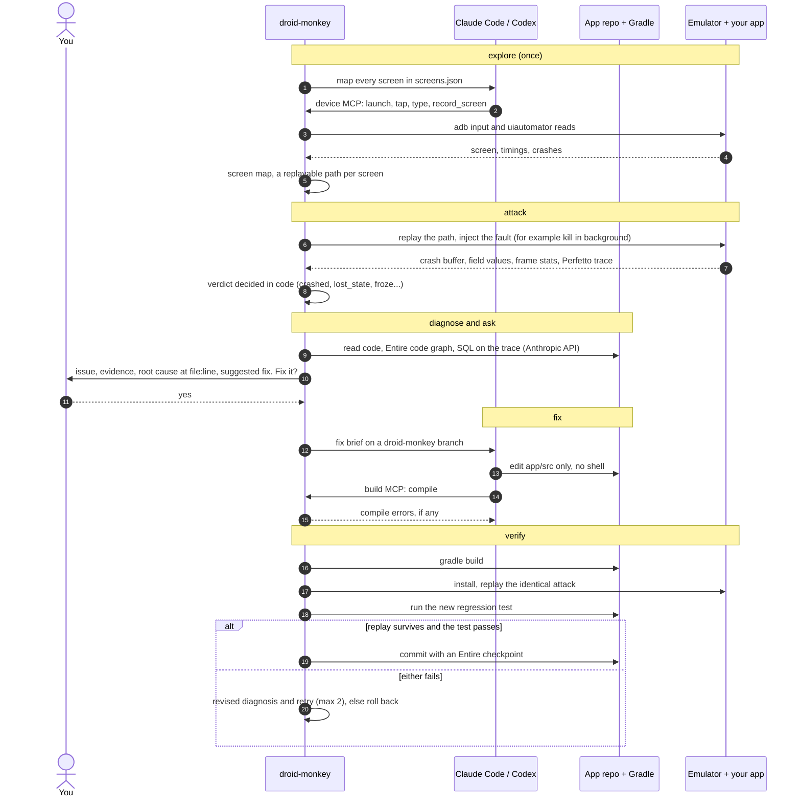

- **Claude Code** runs as `claude -p` with allow and deny rules and no shell. **Codex** runs as `codex exec` in its sandbox. The **API agent** is droid-monkey's own tool loop for people with neither CLI. All three get the same brief and the same two MCP servers, and droid-monkey discards any edit outside `app/src` afterwards.
- **The emulator** is found, booted, health-checked and restarted by droid-monkey (a watchdog restarts a hung device). Screens are read through uiautomator (uiautomator2's on-device helper when installed, about 30 ms a read).
- **Models decide, code judges.** Models plan, explore, diagnose, design attacks and review UX; every verdict (crashed, leaked, froze, fixed) is measured on the device by code.

## Features

**Understand the app**
- **Works on any Android app.** `init` detects the module, applicationId, build variant, AVD and a JDK your Gradle can run on; nothing app-specific lives in droid-monkey's code.
- **Code analysis** (`analyze`): manifest, permissions, dependencies and 10 risk patterns with file:line, then a coding agent's read of the repo → `ANALYSIS.md` and the user flows worth testing.
- **Screen map** (`explore`): a coding agent drives the app on the emulator from a checklist of every screen in the code. Each screen gets a replayable path from launch and the source files behind it. Modes: `agent`, `fast` (no model), `manual` (you drive, it records) and `rules`; time, screen and spend limits.
- **Signed-in apps**: a test account signs in after every launch (`entry_steps`, credentials from `~/.droid-monkey/.env`).

**Find what breaks**
- **7 built-in real-world attacks**: process death, rotation, network loss, permission revoke, low memory, CPU load and slow startup, each on the app's best screens (`--screens`).
- **App-specific attacks**: from the analysed user flows (`attacks from-flows`), designed by an agent for this app (`attacks suggest`), or described in plain words (`attacks new "…"`). Every spec is built from verified building blocks and tried on the emulator before it's saved.
- **Bugs in normal use** (`hunt`), with no fault injected: crashes and swallowed exceptions in the app's logs, `null`/`NaN`/unfilled placeholders and negative money on screen, and logic bugs across a journey found by a model that must quote the screen it cites.
- **UX audit** (`ux`): touch targets, unlabelled icons, taps to reach each screen, predicted attention heatmaps, measured waits against response-time limits, and a model's review of every screenshot.
- **One ranked list** (`issues`): every open issue from attacks, hunt and the UX audit, ranked by user impact.
- **Verdicts measured in code, not guessed**: crash and ANR buffers, field diffs, frame stats, live Activities after a forced GC, cold and hot start times.
- **Deep evidence**: Perfetto traces analysed with trace_processor (what the main thread was doing in each long block), the main thread's stack from Android's own ANR record, leak reference chains from Shark (LeakCanary's analyser), screen recordings, screenshots, UI dumps and logcat for every attack.

**Fix it, and prove it**
- **Root-cause diagnosis** with file:line evidence, using `read_code`, `search_code`, Entire's code graph and SQL over the Perfetto trace.
- **Never changes code without your yes**: every fix shows the issue, the measured evidence, the root cause and the suggested change, and waits.
- **Three coding agents**: Claude Code, Codex, or droid-monkey's own agent on the Anthropic API. The fixer edits only the app's sources, has no shell, and gets a `compile` tool.
- **Proof on the device**: rebuild, replay the identical attack, run the new regression test. Committed only if both pass.
- **Recovery**: a failed fix goes back into a revised diagnosis and the same coder session (up to 2 tries), or is rolled back without touching your other edits. An emulator watchdog restarts a hung device, and `run --resume` continues a killed run.
- **Fix hunt and UX issues** (`fix`): the issue is re-checked on the device and committed only if it's gone.
- **One commit per fix** on a `droid-monkey/<run>` branch, each with an Entire checkpoint; `pr` opens a GitHub PR with the evidence table.

**See and share the results**
- **Live dashboard** (`dashboard`): every run, screen, issue, analysis and file in `.droid-monkey/`, refreshing as runs write; stream the emulator's screen and run any command from the page.
- **Reports**: an HTML report per run with recordings and charts, a PR body, a score card, a receipt with time, tokens and cost per step, and before/after comparisons (`report`, `compare`).
- **Tracing**: every run is one neatlogs trace, with every graph node, model call and coding session.
- **Cost control**: `econ` turns measured costs into the cfo.ai business plan's inputs, and `run --tier` enforces the plan's fix budget.
- **A CLI with character**: ASCII monkey art for every result, a banana meter for the resilience score.

## Attacks

Built-in attacks are generic templates, filled per app from the screen map:

| Attack | Fault | Fails as |
|---|---|---|
| `process_death` | Fill a form, the app is killed in the background like the low-memory killer does, come back | `crashed`, `lost_state` |
| `rotation` | Rotate while work started by a tap is still running, or on a filled form | `crashed`, `lost_state` |
| `network_loss` | Drop wifi and data, then submit or start slow work | `crashed`, `no_feedback` (silent failure) |
| `permission_revoke` | Grant a permission through the app, revoke it the way Settings does, use the feature again | `crashed` |
| `low_memory` | Recreate the screen 3 times, send critical and background trim signals, come back | `leaked`: more live Activities after a forced GC than at the start, or the heap grew by half and 16 MB. On a leak, droid-monkey dumps the heap and runs **Shark** (LeakCanary's analyser, `brew install leakcanary-shark`) for the exact reference chain that holds the screen; if the app ships LeakCanary, its log adds which screens were destroyed |
| `performance` | Busy-loop 4 CPU cores, scroll, use the screen's slowest action, press a key while it runs | `froze`: any frame over 700 ms (Play vitals "frozen"); `anr`: Android declares the app not responding (the main thread's stack is pulled from Android's own ANR record) |
| `slow_startup` | 5 cold starts and 3 hot starts, timed by Android (`am start -W`) | `slow_start`: median cold start ≥ 5 s or hot start ≥ 1.5 s (Play vitals) |

Each built-in attack runs on its **best 2 screens** by default (`--screens N` or `screens_per_attack:` in `monkey.yaml`).

Plus **app-specific attacks**:
- `droid-monkey attacks from-flows`: every risk the analysis found on a user flow (checkout, login, add task...) becomes an attack that walks that flow and injects that fault at the moment the analysis named. On MonkeyMart, the first two found a real crash by backgrounding or rotating the app during a 5 s load, for $0.01.
- `droid-monkey attacks suggest`: the designer agent reads the analysis and the code and writes new attacks for this app.
- `droid-monkey attacks new "rotate the phone while the order is being placed"`: describe one in plain words.

Every spec is validated against the building blocks and the screen map, and can be tried on the emulator before it's saved.

**Perfetto** traces the performance, memory and startup attacks. droid-monkey analyses the trace with trace_processor and shows:
- what the main thread was doing inside each long block: computing, waiting on a lock or sleep, or waiting on disk;
- blocking calls, binder calls, the busiest threads, garbage collection, and memory use over time;
- for slow launches, a breakdown of the slowest one (`bindApplication`, `activityStart`, and the app's own work).

## Install

```bash
uv tool install git+https://github.com/shubhasai/droid-monkey
```

| You need | For |
|---|---|
| Android SDK with `adb`, the emulator, and one AVD | Running the app and the attacks |
| **One coding agent**: [Claude Code](https://claude.com/claude-code) (`claude`), or [Codex](https://github.com/openai/codex) (`codex`), or just an Anthropic API key | Analysis, exploration, fixes |
| An Anthropic API key in `~/.droid-monkey/.env` as `DROID_MONKEY_API_KEY` | droid-monkey's own reasoning (plan, decide, diagnose, design), on Haiku 5.5 by default |
| Optional: `gh` (logged in), [Entire](https://entire.io), a `NEATLOGS_API_KEY` | `pr`, checkpoints, tracing |

**Why setup is quick:**
- **Nothing to change in your app.** No SDK to add, no test code, no instrumentation. droid-monkey drives the app from the outside, through `adb`, and reads its source.
- **One install command, one config command.** `droid-monkey init` finds the package and module, picks an AVD, and chooses a JDK that fits your Gradle version. It checks `adb`, the emulator, the coding agent and the keys, and says exactly what's missing. The result is a short `monkey.yaml` you can read.
- **The same tool for any app.** The three apps below needed no special code: a demo shop, Google's architecture sample and the Wikipedia app.

Keys live in `~/.droid-monkey/.env`. droid-monkey never exports them globally, and strips them from the coding agent's environment.

Step by step, from an empty machine to the first run, with troubleshooting: **[SETUP.md](SETUP.md)**.

## Quickstart

```bash
cd your-android-app
droid-monkey init        # writes monkey.yaml: package, module, AVD, a JDK that fits your Gradle
droid-monkey analyze     # ANALYSIS.md + flows worth testing
droid-monkey explore     # screen map, with the source files behind each screen
droid-monkey attack builtin --diagnose   # see what breaks, and the suggested fixes (no code changes)
droid-monkey run         # the full loop; asks you before every fix
droid-monkey pr <run-id> # push the run's branch and open a PR with the evidence
```

Everything droid-monkey writes goes to `.droid-monkey/` in your repo: analysis, screen map, attack specs, and one folder per run with screen recordings, screenshots, UI dumps, logcat, traces and verdicts.

Every `run` and `attack` ends with a **visual report** (`dashboard.html`). Each attack gets the evidence that fits its failure:
- the **screen recording** of the attack, next to the **same attack replayed after the fix**;
- a before/after table of **lost input**;
- a **main-thread timeline** from Perfetto, with every long block marked;
- **frame-time**, **launch-time** (against the Play vitals limits) and **memory** charts;
- the crash log or Android's **ANR record**;
- the fix's **code diff**.

## Commands

| Command | |
|---|---|
| `init` | Detect module, applicationId, AVD and JDK; write `monkey.yaml`; check prerequisites |
| `analyze [--static-only] [--agent]` | Static profile and the coding agent's read → `ANALYSIS.md`, `flows.json` |
| `dashboard [--port 8787]` | A live local dashboard over everything in `.droid-monkey/`, and a **Commands** page that runs every droid-monkey command from forms built from the CLI itself: output streams into the page, consent prompts ("Fix it?") get Yes/No/All buttons, Stop sends Ctrl+C, one job at a time; publishing (`pr`) needs an extra confirmation. Every command request needs the server's token from its own pages: runs with their evidence and reports, screens with attention heatmaps, the analysis, user flows, saved attacks, the UX audit and every file. It follows the folder: when a run writes something, the open page refreshes. Listens on 127.0.0.1 only |
| `explore [--mode agent\|fast\|manual\|rules] [--agent] [--minutes N] [--max-screens N] [--check-paths] [--from-partial]` | Screen map. Agent mode stops at 10 min / 60 screens by default (`explore_minutes`, `explore_max_screens`, `explore_max_usd`, `verify_minutes` in `monkey.yaml`) and keeps what it mapped; Each path is checked when an attack replays it (`--check-paths` replays them all right away); `--from-partial` re-checks the paths of an interrupted run's map or the saved one. `manual`: you drive, droid-monkey records. `rules` is a free tap-everything explorer with no model |
| `attack NAME\|builtin\|custom\|all [--diagnose] [--target --action]` | Run attacks, no fixing. Builds first if the installed app wasn't built from the current source |
| `issues [--rerank]` / `fix ISSUE` | Every open issue (attacks, hunt, UX) in one list, **ranked by Jev** (TypeSafe): expected impact on users × how likely it is a real bug (severity fallback without a key). `fix` repairs one hunt/UX issue with your consent, re-checks it on the device and commits only if it is gone; attack failures go through `run --attacks NAME`. The dashboard's **Issues** page has a Fix button on each |
| `hunt [--no-model]` | Bugs in **normal use**, no fault injected: walks every recorded path like a user and checks the app's logs after each step (crashes, exceptions the app caught and only logged, main-thread jank, leaked windows), every screen (`null`/`NaN`/unfilled placeholders, negative money, blank screens, duplicate rows) and, with a model reading the screenshots, each journey's numbers and messages. A model finding must quote text that is really on the screen it cites, or it is dropped → `HUNT.md`, `issues.json` |
| `ux [--no-apply] [--agent api\|claude\|codex] [--review-model M]` | **UX audit** of every mapped screen: predicted attention heatmaps, waits measured against Nielsen's limits, tap targets under 48 dp, unlabelled controls, taps from launch, and a model's review of every screenshot with the code behind it. Each finding comes as a change (problem, evidence, why it matters, the edit, the files); findings seen on the device and ones suspected from code only are labelled apart. Then it asks about each finding; a yes has a coding agent make the change, which is discarded if the app doesn't build; otherwise droid-monkey reopens the screen for a before/after screenshot and commits it (`--no-apply` only writes the audit) → `UX_AUDIT.md`, `ux-audit.html`, `attention/` |
| `attacks list\|show\|suggest\|new\|from-flows` | Built-in and app-specific attack types; the designer agent; attacks from the analysed user flows |
| `run [--attacks a,b] [--screens N] [--agent] [--auto-fix] [--resume ID]` | The full loop. `--auto-fix` skips the question (CI); `--resume` continues a killed or paused run. Every run ends with a **receipt**: what was found and fixed, time, and tokens and cost per step |
| `report RUN` / `compare A B` / `pr RUN` | PR body, score card and dashboard / before-after table / push and open the PR |

### Coding agents

`--agent` or `agent:` in `monkey.yaml`: `auto` (default) picks the first one that's set up.

| | Claude Code | Codex | API agent |
|---|---|---|---|
| Runs as | `claude -p` | `codex exec --json` | droid-monkey's own tool loop on the Anthropic API |
| Limits enforced | Allow and deny rules, no shell | Read-only or workspace-write sandbox; can't stop it reading docs | The same allow and deny rules, applied by its file tools; no shell |
| droid-monkey's device and compile tools | MCP | MCP | MCP client |
| Cost in neatlogs | Exact, as Claude Code reports it | Tokens only | Priced per call |
| Entire checkpoints | ✅ | With `entire agent add codex` | ✗ (not yet) |


## Signed-in screens (test accounts)

droid-monkey never logs in, signs up, posts or pays on an app's **live** backend: every such tap is refused. To reach
the screens behind a login, give it a **test account** and it signs in after every launch:

```yaml
# monkey.yaml
entry_steps: ["tap text:Log in", "type username=${DM_TEST_USER}", "type password=${DM_TEST_PASSWORD}", "tap login_button"]
entry_check: "text:Watchlist"   # something only a signed-in user sees: the run stops if the sign-in failed
live_backend: false             # only when the app points at a test/staging backend
```

The credentials come from your environment or `~/.droid-monkey/.env`, never from `monkey.yaml`. While signed in,
droid-monkey refuses to tap Log out / Sign out (so a run keeps its session), and the explorer is told to explore the
signed-in screens without changing the account. Keep `live_backend: true` (the default) unless the build talks to a
test backend: then sign-up, posting and paying stay refused even while signed in.

## Results

### architecture-samples (Google): one real bug, three approaches
[android/architecture-samples](https://github.com/android/architecture-samples) is Google's reference app for Android architecture (Compose, ViewModels, Hilt). droid-monkey found a real process-death bug in it: a half-typed new task is lost when the OS kills the app in the background. It then fixed it three ways, from the same base commit. The fix of each approach was judged the same way, by droid-monkey's device replay.

| | Plain Claude Code (generic prompt, no droid-monkey) | droid-monkey, no diagnosis | **droid-monkey** |
|---|---|---|---|
| Process-death bug fixed | ✅ | ✅ first try | ✅ first try |
| Coder tokens | 2,167,816 | 220,546 | **167,297** |
| Cost | $2.46 | $0.43 | **$0.39** |
| Change | 14 files, +424/−36, mostly speculative hardening never checked on a device | 2 files, +56/−4 | **2 files, +55/−5** |

Without a reproduction or a stack trace, plain Claude Code read its way through the repo: about 13× the tokens. It also changed code for faults that, on the device, don't happen. droid-monkey's diagnosis pointed the coder at `AddEditTaskViewModel.kt:59`.

### MonkeyMart: 4 planted bugs
Same 4 attacks, same base. Each version fixed a weakness found in the previous version's run data.

| Version | Fixed | Coder tokens | Cost | Time |
|---|---|---|---|---|
| Plain Claude Code (no droid-monkey; judged by droid-monkey afterwards) | 4/4, nothing checked on a device | 828k | $1.35 | 3.1 min |
| v1, no diagnosis | 4/4 | 575k | $1.28 | 8.0 min |
| v2, + diagnosis | 4/4 (1 retry) | 793k | $2.09 | 11.4 min |
| v3, + compile tool | 4/4 (1 retry) | 743k | $1.78 | 11.1 min |
| **v4, + JVM-first test plans** | **4/4, all first try** | **498k** | **$1.27** | 8.8 min |

What each version added, and what it bought:
- **v1 → v2, diagnosis.** The coder gets the root cause from the code and the device evidence (crash, logcat, Perfetto, leak counts) instead of only "it failed". The fixes became specific: compare v1's commit `fix(rotation): survive rotation` with v4's `fix(rotation): tie deal popup coroutine to lifecycle, not GlobalScope`.
- **v2 → v3, a compile tool.** The coder can build the module before it finishes, so broken fixes don't reach the device.
- **v3 → v4, JVM-first test plans.** The diagnosis plans a JVM regression test where possible, instead of a slow instrumented one. Every fix then passed on the first try.

From v2 to v4: **37% fewer coder tokens (793k → 498k), 39% lower cost ($2.09 → $1.27), 23% faster (11.4 → 8.8 min), no retries.**

To be clear about what this shows: on a small app with textbook bugs, plain Claude Code fixes everything by reading code, and does it faster. droid-monkey's value is the part reading can't do:
- finding which faults actually break the app;
- reproducing them on a running device;
- proving each fix by replaying the identical attack;
- the evidence trail.

Its advantage grows on bigger codebases and on bugs with no stack trace. All results are single runs.

### Wikipedia: a large real app, and the UX audit
The [Wikipedia Android app](https://github.com/wikimedia/apps-android-wikipedia) is a large production codebase. droid-monkey mapped **40 screens** from its code and the device, without any changes to the app. It then ran `droid-monkey ux` on it ($1.17, Sonnet 5.5). The audit combines three kinds of evidence:

- **Predicted attention heatmaps** for every screen. A saliency model (spectral residual) is combined with a prior from the UI structure, and each screen gets a heatmap plus the share of attention each control is likely to get. Five screens were flagged where the main action loses to something else. On the first onboarding screen, "Learn more about Wikipedia" is predicted to draw **16× the attention of the Forward button (18% vs 1%)**. On the interests screen, **Next ranks 7th of 8 controls**.
- **Measured waits** on every route, against Nielsen's limits (0.1 s instant, 1 s keeps the flow, 10 s loses attention). Cold start was 1.59 s; 8 steps broke the flow, for example opening a file page took 2.3 s.
- **What was observed versus suspected.** There are **9 findings: 7 seen on the device, 2 suspected from the code only**, and the two are labelled differently. The top one, rated high, is real: a Year in Review promo covers an article the user has just opened.

| First onboarding screen: the eye goes to the headline and "Learn more", not Forward | Interests: Next ranks 7th of 8 |
|---|---|
|  |  |

<details>
<summary><b>All 40 heatmaps</b> (the 5 screens where the main action loses come first; on the <a href="https://shubhasai.github.io/droid-monkey/#ux">landing page</a> they're in a carousel with each screen's numbers)</summary>

| | | | | |
|---|---|---|---|---|
| <br><sub>Onboarding 1: welcome</sub> | <br><sub>Onboarding 4: interests</sub> | 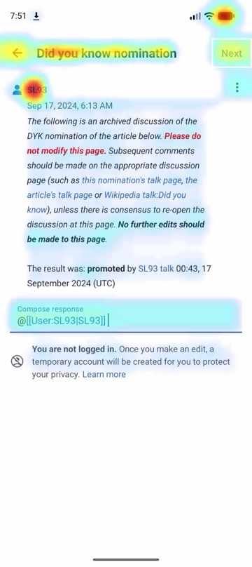<br><sub>Talk reply</sub> | 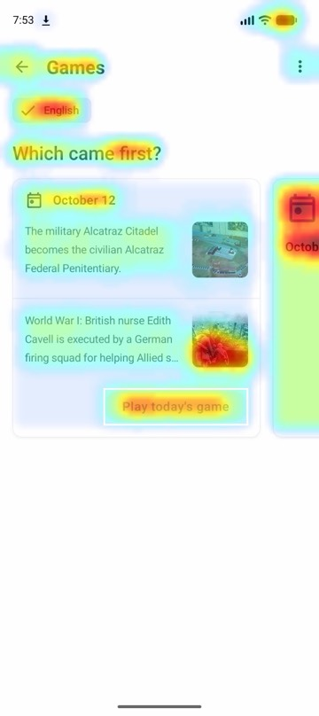<br><sub>Games hub</sub> | 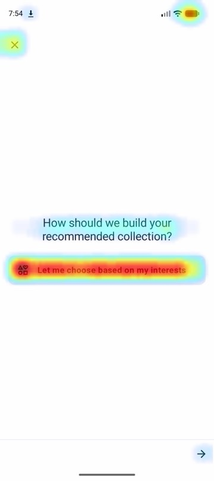<br><sub>Reading list: source</sub> |
| <br><sub>Onboarding 2: languages</sub> | 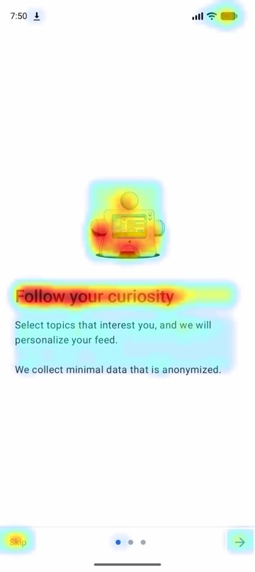<br><sub>Onboarding 3: curiosity</sub> | 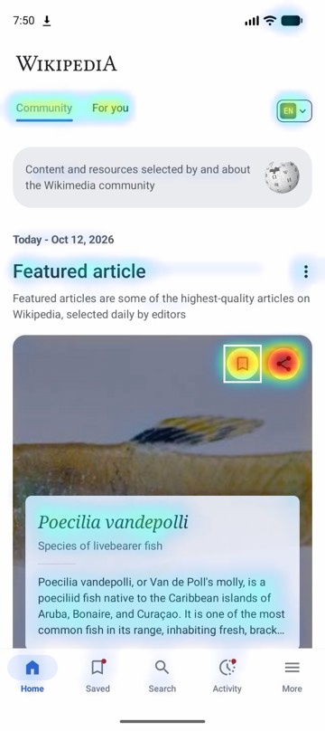<br><sub>Home feed</sub> | <br><sub>Article (after tap)</sub> | <br><sub>Talk topic</sub> |
| <br><sub>Edit history</sub> | 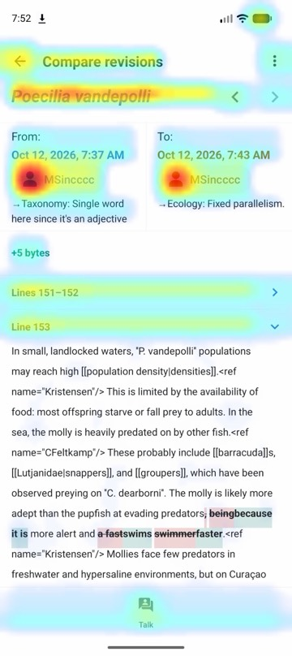<br><sub>Edit details (diff)</sub> | 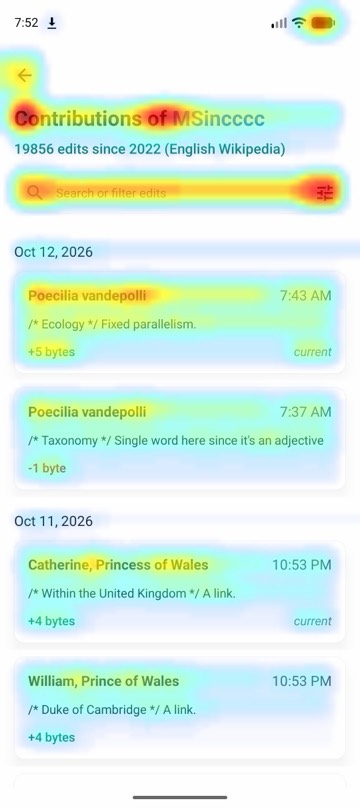<br><sub>User contributions</sub> | 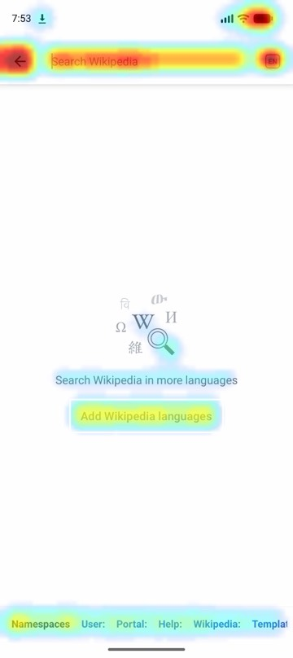<br><sub>Search</sub> | <br><sub>Year in Review</sub> |
| <br><sub>Settings</sub> | <br><sub>Community modules</sub> | <br><sub>Donation reminder</sub> | 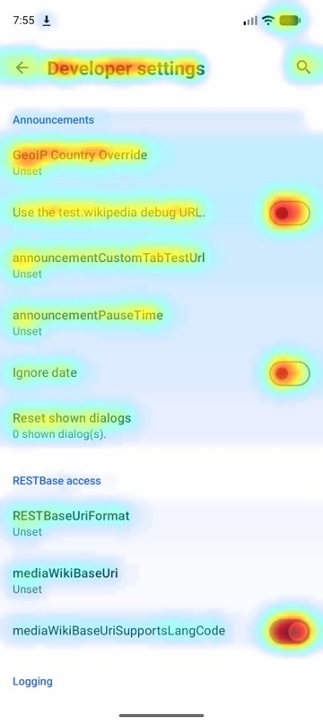<br><sub>Developer settings</sub> | 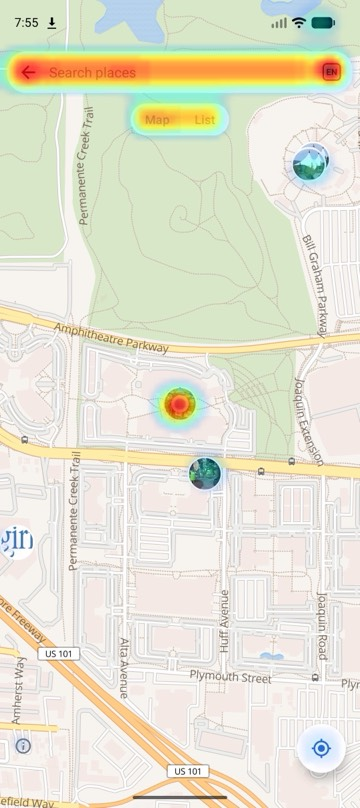<br><sub>Places</sub> |
| <br><sub>On this day</sub> | 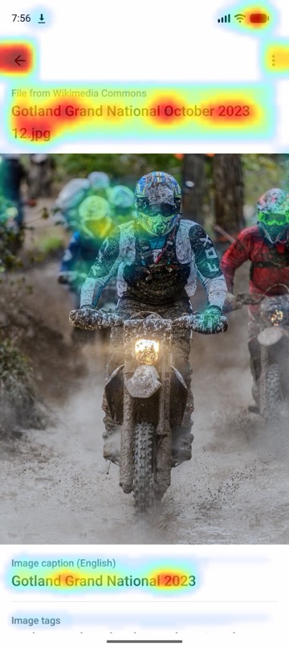<br><sub>File page (Picture of the day)</sub> | <br><sub>Talk topics</sub> | 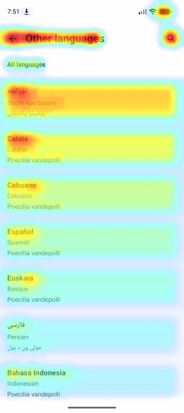<br><sub>Article languages</sub> | 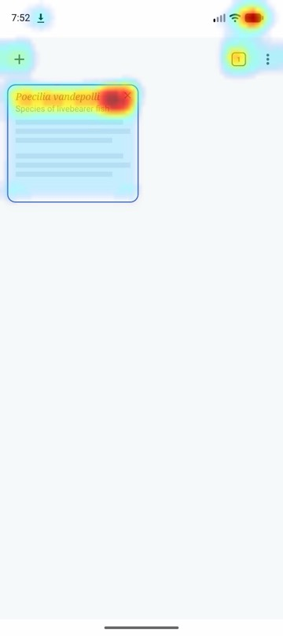<br><sub>Tabs</sub> |
| 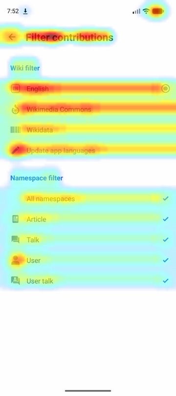<br><sub>Contributions filter</sub> | <br><sub>Wikipedia languages</sub> | 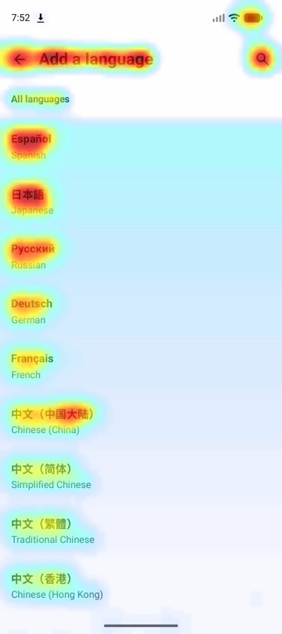<br><sub>Add a language</sub> | <br><sub>Install widget</sub> | <br><sub>History</sub> |
| 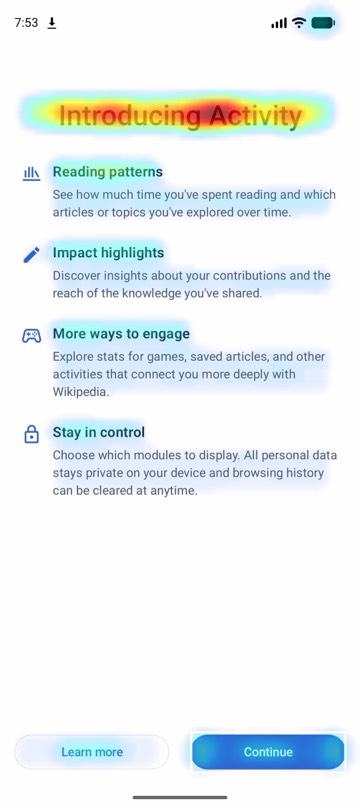<br><sub>Feature onboarding</sub> | 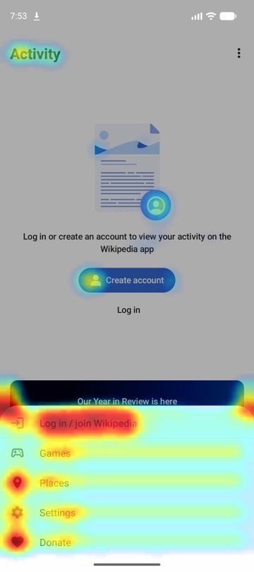<br><sub>Main menu</sub> | 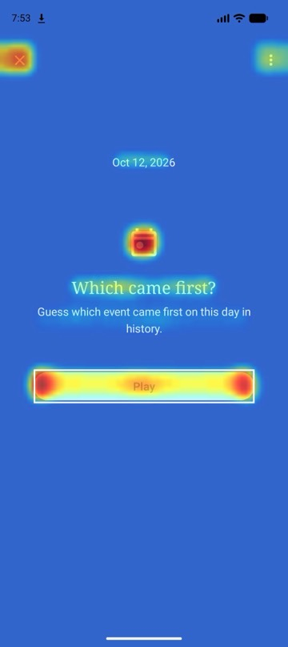<br><sub>On this day game: menu</sub> | <br><sub>On this day game: play</sub> | 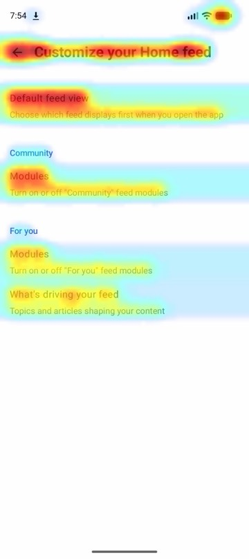<br><sub>Home feed settings</sub> |
| 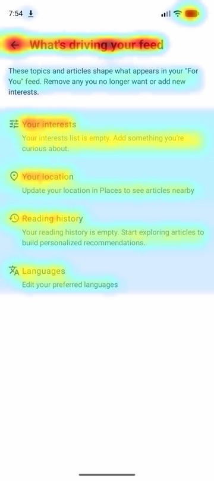<br><sub>Feed configuration</sub> | 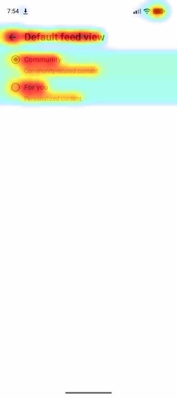<br><sub>Default feed view</sub> | 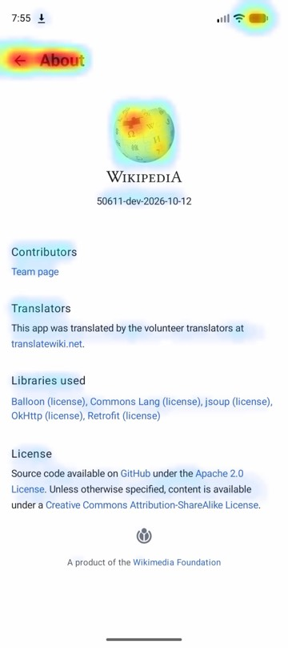<br><sub>About Wikipedia</sub> | 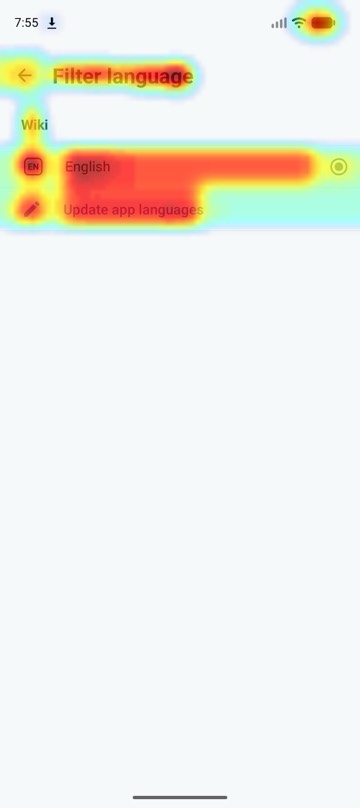<br><sub>Places filter</sub> | <br><sub>Did you know</sub> |
</details>

#### How the UX audit helps
- **It finds problems that never crash.** A user who can't find the way forward, waits 2 s after a tap, or hears "View" from TalkBack just leaves. No crash report, no stack trace, nothing in the logs.
- **It shows what users will miss before they miss it.** The heatmap predicts where the eye goes and gives each control a share of attention, so a main button that loses to a link or an image shows up as a number.
- **It measures instead of guessing.** Waits are timed on the device, tap targets measured in dp, labels read from the UI dump, taps counted from launch.
- **It gives a change, not a complaint.** Each finding says what to edit and in which file, and joins the same ranked `issues` list as crashes and leaks, so UX work is prioritised against everything else.
- **It keeps evidence honest.** What was seen on the device and what was only suspected in the code are labelled apart.

#### What the agent suggests changing in Wikipedia
The 7 findings seen on the device, each with the change the review proposed. These are proposals: no changes were made to Wikipedia.

| Severity | Seen on the device | Suggested change | Files |
|---|---|---|---|
| **high** | Tapping the featured article waits 1.2 s, then shows a full-screen Year in Review promo instead of the article | Show announcements only on the main screen, not on `PageActivity`; or only after the article has loaded and the user has scrolled | `BaseActivity.kt` |
| medium | Onboarding's only main action is a small arrow: "Learn more" draws 16× its attention, Next ranks 7th of 8, Home is 5 taps away, Skip appears only on screen 3 | A filled, labelled "Continue" button; Skip on every step; a smaller "Learn more" | `InitialOnboardingScreen.kt`, `PersonalizationScreen.kt` |
| medium | TalkBack reads six unnamed "View" switches on Community modules (and more in Settings and the donation reminder); only the small switch takes the tap | Make the whole row one toggleable control with the switch role: "Featured article, switch, on" | `Settings.kt`, `CommunityModulesScreen.kt`, `DonationReminderScreen.kt` |
| medium | Reading-list setup: an unlabelled Forward arrow, last of 4 controls, then 3.7 s with nothing on screen | A full-width "Next" button with progress once tapped; start the fetch when the screen opens | `RecommendedReadingListSourceScreen.kt` |
| medium | Tap targets under 48 dp: a 16 dp-tall contribution row (unlabelled), a 32 dp date picker, 44 dp Map/List toggles, an unlabelled My location button | Content descriptions, full-card rows, 48 dp touch areas | `UserContribItemView.kt`, `EditHistoryItemView.kt`, `PlacesFragment.kt` |
| low | The talk reply box opens with raw `@[[User:SL93\|SL93]]`, 4.4× the attention of Next | Show the mention as a chip or "@SL93"; convert to wikitext only when sending | `TalkReplyActivity.kt` |
| low | Opening the Picture of the day takes 2.3 s with nothing showing it's loading | Show the title and the feed's thumbnail at once, with progress for the details | `FilePageFragment.kt` |

Plus 2 suspected from the code only, on screens nobody reached (for example an inverted check in `EditSectionActivity.kt` that can overwrite an unsaved edit after the Activity is recreated). They don't count as findings until an attack reproduces them.

The heatmaps are predictions, not eye tracking, and each finding says whether it is observed or suspected. The attacks also found a real leak in Wikipedia: `YearInReviewOnboardingActivity` instances stay alive after a forced GC (1 → 3).

### Performance, memory and startup
These were checked on bugs planted on a scratch branch, plus both apps as they are:

| Planted bug | Measured | Diagnosis |
|---|---|---|
| `Thread.sleep(1500)` in a click handler | `froze`: input handler asleep for 1500 of 1501 ms | Pointed to the exact line. Fixed with Claude Code (16 s) and with the API agent (22 s, $0.08) |
| Activity added to a static list | `leaked`: 1 → 7 live Activities after a forced GC | Found the static list and ruled out two other suspects |
| 5.5 s busy loop in `onCreate` | `slow_start`: cold start median 5946 ms | `performCreate` running for 5525 ms; pointed to the loop |

No false alarms on either app as it is.

## How a fix is made

1. **Diagnose.** The diagnoser reads the failure's evidence: the crash, logcat, the Perfetto main-thread timeline, leak counts and screenshots. It also reads the app's code, through code search and **Entire's code graph** (`entire graph search` finds the symbols, callers and covering tests). It returns the root cause with `file:line`, the files to change and a regression-test plan.
2. **Ask.** droid-monkey shows you the diagnosis and the evidence and asks **"Fix it?"**, in the terminal or with a button on the dashboard. Nothing changes without a yes, unless you pass `--auto-fix`.
3. **Fix.** The coding agent, Claude Code by default, works on a `droid-monkey/run-…` or `droid-monkey/fix-…` branch, never yours. It has only read and edit tools, plus a compile tool. Only its edits under `app/src` are kept.
4. **Verify.** droid-monkey rebuilds the app, **replays the identical attack** and runs the regression test. The fix is committed only if both pass. If not, the failure goes back into a revised diagnosis (at most 2 attempts), and if it still fails the sources are restored.
5. **Commit and PR.** The commit message carries the root cause, the fix and the evidence. **Entire records the Claude Code session that wrote it, and the commit gets an `Entire-Checkpoint` trailer.** `droid-monkey pr` opens a pull request with the before/after evidence table, for example [MonkeyMart PR #2](https://github.com/shubhasai/MonkeyMart/pull/2).

**What Entire adds:** open the commit on entire.io to see the session behind the fix: the brief droid-monkey gave the agent, the diagnosis, every step, the tokens and the diff. That answers "why did this line change, and who changed it" for code written by an agent. The checkpoints are pushed with the repo: 32 on MonkeyMart, and the sessions that built droid-monkey itself. Details: [evidence/entire.md](evidence/entire.md).

## Tracing and checkpoints

How each partner tool is used, with the evidence: [evidence/](evidence/README.md) ([neatlogs](evidence/neatlogs.md) · [Entire](evidence/entire.md) · [cfo.ai](evidence/cfo-ai.md)).

- **neatlogs:** every run is one trace. It covers every graph node and every model and tool call, and each `claude -p` session is an LLM span with its exact tokens and cost. The app is the "end user" and the run id is the session.
- **Before and after, in neatlogs:** the MonkeyMart v1 and v4 runs side by side (in v4 every fix lands first try, with 13% fewer coder tokens), and the trace of the recovery run: [evidence/neatlogs.md](evidence/neatlogs.md#before-and-after-an-improvement-in-neatlogs).
- **Entire:** the Claude Code session that built droid-monkey itself is attached to this repo as a checkpoint, and every fix commit droid-monkey makes in an app carries an `Entire-Checkpoint` trailer linking it to the recorded Claude Code session that wrote it. The diagnoser also uses Entire's code graph to find the symbols involved.

### How neatlogs helped

droid-monkey is an agent that drives other agents: Claude Code sessions for analysis, exploration, diagnosis and fixes, plus its own Claude calls for planning and decisions. Most of that work happens in separate `claude -p` processes, so droid-monkey's own logs only see what each session reports back. neatlogs puts all of it in one trace per run:

- **One timeline per run.** The LangGraph nodes (plan, attack, decide, diagnose, fix, verify, commit), every API call (LangChain and Anthropic instrumentation), and every Claude Code session as an LLM span.
- **Real cost.** Claude Code sessions carry the tokens and cost Claude Code reports. API calls are priced per call, so a run's spend is visible per step, not just as a total.
- **Per app and per run.** The app's package is the end user and the run id is the session, so the traces for one app, or one run, are easy to find.

**It caught a failure we could not see.** On 12 Oct, neatlogs raised the incident *Explorer returns empty response without mapping screens* (`981cb137`, medium). It came from one trace: the `explore` session made no tool calls, returned an empty answer and reported zero output tokens. droid-monkey's own logs showed no error for it. The only traceback in that day's job logs was an unrelated device error. The session had "succeeded" as far as droid-monkey could tell.

**The trace pointed at the cause.** An empty LLM span with no tool calls meant the agent had stopped without touching the device. Following that into the code showed two gaps. First, an empty or errored `claude -p` result was treated as a success, and `explore` never checked it. Second, if an older `screen-map.json` was on disk, `explore` returned that map as if this run had made it. So a run that mapped nothing could look like a finished exploration.

**The fix, and how it shows in neatlogs now:**
- A `claude -p` result that is an error, or has no text and no output tokens, is a failure with a reason. This applies to every Claude Code session droid-monkey runs: analysis, exploration, diagnosis and fixes.
- The reason is set on the span as `claude_code.error`, with ERROR status. A failure like this one now shows up in neatlogs as a named failure, not an empty success.
- `explore` retries once when the agent recorded no screens, then stops and says why.
- A map only counts if this run wrote screens to it, so an earlier map is never passed off as new.
- `tests/test_empty_sessions.py` covers the empty and errored results, the retry, and keeping the earlier map.

Every incident neatlogs raises about droid-monkey is handled the same way: read the trace, find the cause, fix it, add a test, and record it here.

| Incident | What the trace showed | Cause in droid-monkey | Fix |
|---|---|---|---|
| Explorer returns empty response without mapping screens (`981cb137`, medium) | `explore` session: no tool calls, empty answer, zero output tokens | Empty or errored `claude -p` results counted as success; `explore` could return an older map as this run's | Empty or errored sessions fail with a reason (`claude_code.error`, ERROR status); explore retries once; only a map this run wrote counts |

## Business plan (cfo.ai)

droid-monkey sells as a CI add-on for Android teams. The plan is built in cfo.ai from droid-monkey's own measured costs, and the plan in turn sets how much the agent may spend on each run.

**Model (public, read-only): [cfo.ai/s/dcL7ulePdgkkZNCB](https://cfo.ai/s/dcL7ulePdgkkZNCB)** · full write-up: [docs/cfo-plan.md](docs/cfo-plan.md)

1. **Measure:** `droid-monkey econ --app-dir <app> ...` reads every run and writes [`business/drivers.csv`](business/drivers.csv). Each row is a cost or an assumption, with its source and whether it was measured. Attacks cost $0 in model spend (31 s each). The money goes on fixes: $0.56 per fix attempt, $1.12 per verified fix.
2. **Model:** cfo.ai's Ari built the model from `drivers.csv` with three plans (Free, Team $99, Scale $499, plus $3 per verified fix) and six scenarios over 18 months.
3. **Enforce:** the 70% margin floor sets a fix budget per tier in `business/unit_economics.json`. `droid-monkey run --tier team` keeps attacking once the budget is spent but stops fixing, and each check is a `budget` GUARDRAIL span in neatlogs.

| Scenario | Scale margin | Team margin | Month-18 cash |
|---|---|---|---|
| Base | 67.1% | 69.8% | $22,618 |
| No budget cap | **−5.6%** | 45.0% | $10,852 |
| Scale repriced ($986.97) | 70.0% | 69.8% | $29,732 |
| Usage pricing | 74.0% | 80.7% | $44,764 |

**What cfo.ai showed:** the fix budget is what keeps droid-monkey profitable. Without it, Scale loses money on every run. Scale at $499 covers only about 52% of expected fix demand; covering all of it at a 70% margin takes $986.97 a month. None of the six scenarios runs out of cash within 18 months.

## Safety

- **Consent:** no code changes without your explicit yes for each attempt, or `--auto-fix`.
- **Isolation:** analysis and exploration work on a **copy** of your source. Fixes happen on a separate branch, and you're returned to yours at the end.
- **Only the fix is kept:** droid-monkey keeps only edits inside `app/src` made by the coding agent, and discards anything else.
- **No arbitrary commands:** attack specs are built only from validated building blocks. The coding agent never gets a shell (except Codex, inside its sandbox).
- **Same code, same build:** droid-monkey never diagnoses a build that wasn't built from the source it's reading. It rebuilds when they differ.

## Known limitations

- Codex mode is implemented from OpenAI's docs but hasn't been tested end to end.
- API-agent fixes have no Entire checkpoint yet.
- Measurements come from a debug build on an emulator: slower than release on a phone, so a pass is conservative.

## Building in public

Posts on X during the hackathon ([@m_shubhasai](https://x.com/m_shubhasai), #neatHack):

| When (IST) | Post | |
|---|---|---|
| Oct 11, 20:19 | [The announcement](https://x.com/m_shubhasai/status/2109295434481160496) | An agent that attacks Android apps the way real life does, fixes what breaks, and proves each fix by replaying the same attack. |
| Oct 12, 15:29 | [The CLI](https://x.com/m_shubhasai/status/2109584845097914621) | “No bananas were harmed in making this run.” |
| Oct 12, 18:15 | [A bug hunt found](https://x.com/m_shubhasai/status/2109626631447019842) | “Add ₹-5 more for free delivery.” Found by droid-monkey's hunt before customers found the loophole. |
| Oct 12, 18:50 | [The recovery path](https://x.com/m_shubhasai/status/2109635351279206501) | “Your fix is wrong.” The fix passed every test; droid-monkey revised its diagnosis and rethought the design. |

Landing page: [shubhasai.github.io/droid-monkey](https://shubhasai.github.io/droid-monkey/)

## Built with

Python 3.12 · LangGraph · Claude (Haiku 5.5 for reasoning, Sonnet 5.5 for code) · Claude Code / Codex · MCP · adb, emulator, Gradle · Perfetto · neatlogs · Entire

Sample app: [shubhasai/MonkeyMart](https://github.com/shubhasai/MonkeyMart)

License: [MIT](LICENSE)
