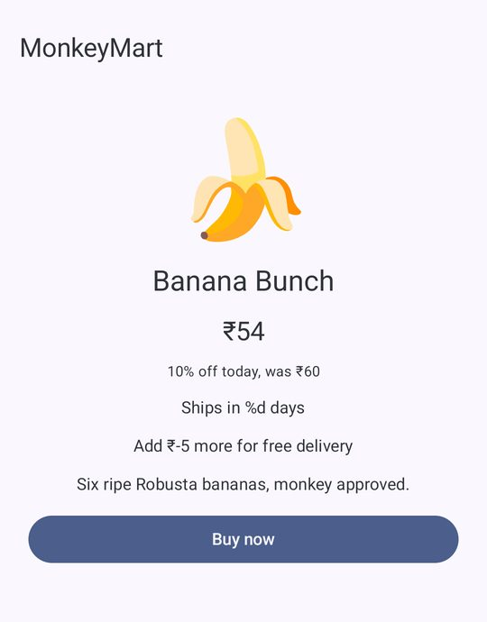
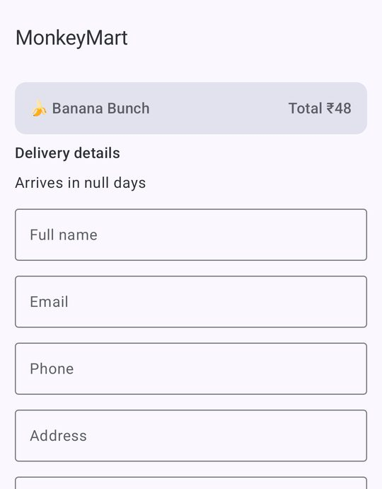
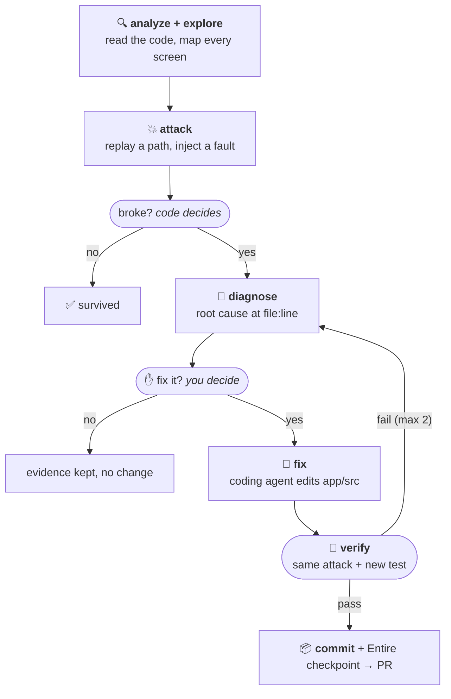
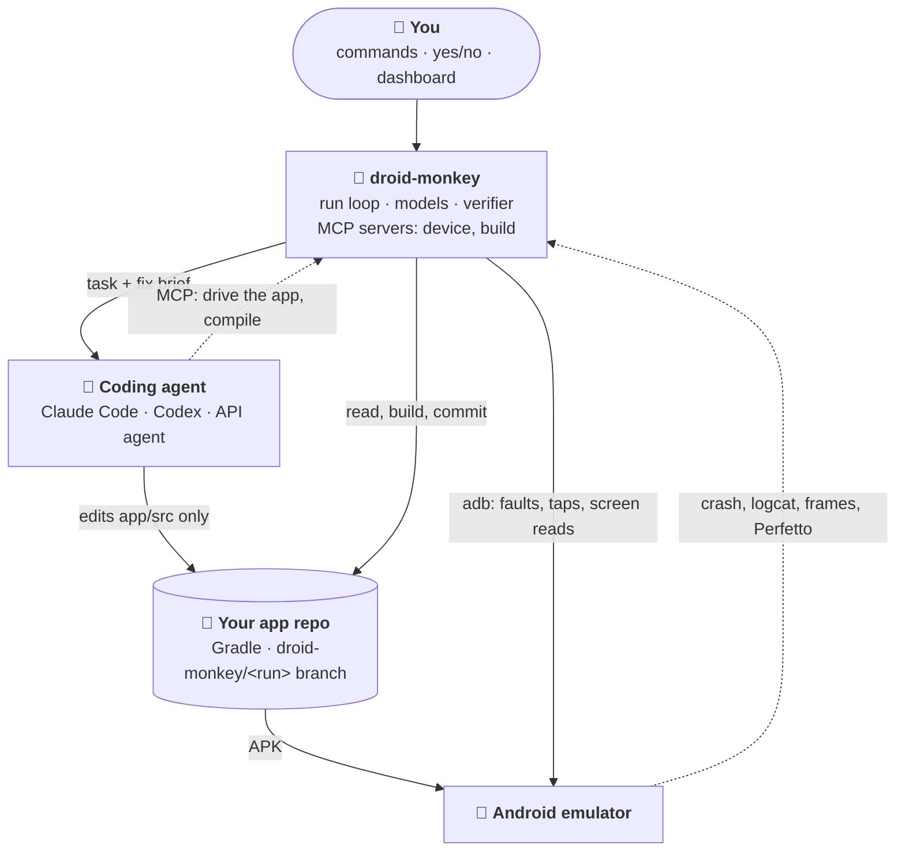
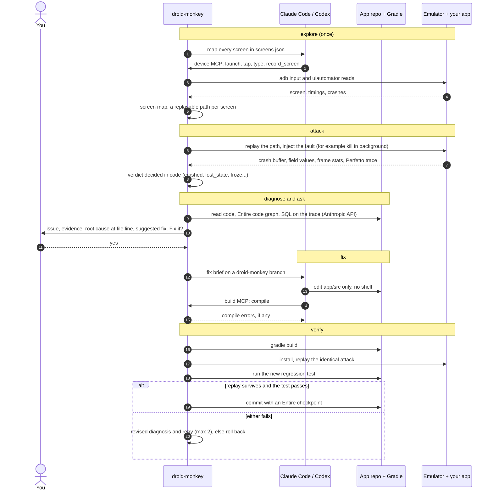
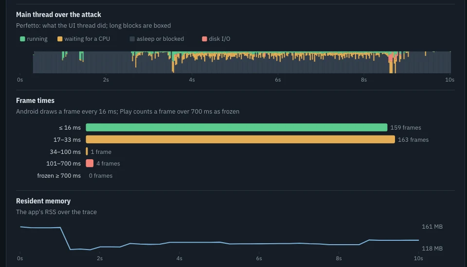

<div align="center">

# 🐒 droid-monkey

**Break your Android app the way real phones do. Fix what breaks. Prove every fix on a running device.**

[](https://youtu.be/61sALQcY_LY)
[](https://shubhasai.github.io/droid-monkey/)
[](https://x.com/m_shubhasai/status/2109685797603680453)


<table>
<tr>
<td align="center" width="33%"><br><sub><b>hunt</b>: an unfilled <code>%d</code> and “Add ₹-5 more”</sub></td>
<td align="center" width="33%"><br><sub><b>hunt</b>: the deal applied twice, “Arrives in null days”</sub></td>
<td align="center" width="33%"><br><sub><b>ux</b>: on Wikipedia, “Learn more” draws 16× the attention of Forward</sub></td>
</tr>
</table>

<sub>Real screenshots from droid-monkey runs. Nothing staged.</sub>

</div>

---

Real phones are hostile to apps. Android kills them in the background, users rotate mid-task, the network drops, permissions get revoked in Settings, memory runs low and the CPU is busy.

**droid-monkey does all of that to your app on an emulator.** It measures exactly what broke and finds the root cause in your code. Then it **asks you** before a coding agent writes the fix. It replays the **identical** attack plus a new regression test, and commits only if both pass.

> [!IMPORTANT]
> **It found a real bug in Google's official Android sample.** In [`android/architecture-samples`](https://github.com/android/architecture-samples), a half-typed task is lost if Android kills the app in the background. droid-monkey reproduced it on a device, traced it to `AddEditTaskViewModel.kt:59`, and fixed it on the first try with a `SavedStateHandle` and a regression test, using **13× fewer tokens than plain Claude Code** ([details](#architecture-samples-google-one-real-bug-three-approaches)).

<table>
<tr>
<td align="center"><h3>13×</h3><sub>fewer coder tokens than plain Claude Code on Google's sample</sub></td>
<td align="center"><h3>40</h3><sub>Wikipedia screens mapped, with no change to the app</sub></td>
<td align="center"><h3>4 / 4</h3><sub>MonkeyMart bugs fixed first try, each proven on the device</sub></td>
<td align="center"><h3>$0</h3><sub>model spend per attack; verdicts are measured in code</sub></td>
</tr>
</table>

<p align="center">
<a href="#quickstart">Quickstart</a> ·
<a href="#how-it-works">How it works</a> ·
<a href="#features">Features</a> ·
<a href="#attacks">Attacks</a> ·
<a href="#commands">Commands</a> ·
<a href="#results">Results</a> ·
<a href="#tracing-and-checkpoints">Tracing</a> ·
<a href="#business-plan-cfoai">Business plan</a> ·
<a href="#safety">Safety</a>
</p>

## Quickstart

```bash
uv tool install git+https://github.com/shubhasai/droid-monkey

cd your-android-app
droid-monkey init       # detect package, module, AVD and JDK → monkey.yaml
droid-monkey analyze    # read the code → ANALYSIS.md + flows worth testing
droid-monkey explore    # map every screen on the emulator
droid-monkey attack builtin --diagnose   # what breaks, and why (no code changes)
droid-monkey run        # the full loop: asks you before every fix
droid-monkey pr <run>   # open a PR with the evidence
```

| You need | For |
|---|---|
| Android SDK with `adb`, the emulator and one AVD | Running the app and the attacks |
| **One coding agent**: [Claude Code](https://claude.com/claude-code), [Codex](https://github.com/openai/codex), or just an Anthropic API key | Analysis, exploration, fixes |
| `DROID_MONKEY_API_KEY` (Anthropic) in `~/.droid-monkey/.env` | droid-monkey's own reasoning, on Haiku 5.5 by default |
| *Optional:* `gh`, [Entire](https://entire.io), `NEATLOGS_API_KEY`, `TYPESAFE_API_KEY` | `pr`, checkpoints, tracing, issue ranking |

> [!TIP]
> **Nothing to change in your app.** There's no SDK, no test code and no instrumentation. droid-monkey drives the app from outside through `adb` and reads its source. `init` checks every prerequisite and tells you exactly what's missing. For a full walkthrough from an empty machine, see **[SETUP.md](SETUP.md)**.

Everything droid-monkey writes goes to `.droid-monkey/` in your repo. Every run ends with a visual report, and `droid-monkey dashboard` serves a live page over all of it.

## How it works



| Step | What happens |
|---|---|
| **analyze** | Static scan (manifest, permissions, 10 risk patterns), then a coding agent writes `ANALYSIS.md` and the user flows worth testing |
| **explore** | A coding agent drives the app from a checklist of every screen in the code (activities, Compose screens, routes, fragments, dialogs). Each screen gets a replayable path from launch and the source files behind it |
| **attack** | A fault built from fixed, verified building blocks. The result is judged **in code**: crash/ANR buffer, field diffs, frame stats, live Activities after GC, launch times, a Perfetto trace |
| **diagnose** | An agent reads the code, Entire's code graph and SQL over the Perfetto trace, and returns the root cause with `file:line`, a fix and a test plan |
| **ask you** | **No code changes without a yes.** Every attempt, retries included, shows the evidence and the fix, and waits for **yes / no / all** |
| **fix** | Claude Code, Codex or the API agent edits only `app/src` on a `droid-monkey/<run>` branch. No shell, no build files. One extra tool: `compile` |
| **verify** | Rebuild, replay the identical attack, run the new test. Both must pass, or it retries with a revised diagnosis (max 2) or rolls back |
| **commit** | One commit per fix with the root cause, the evidence and an Entire checkpoint. You're returned to your branch, and `pr` opens a PR ([example](https://github.com/shubhasai/MonkeyMart/pull/2)) |

> **Models decide, code judges.** Models plan, explore, diagnose, design attacks and review UX. Every verdict (crashed, leaked, froze, fixed) is measured on the device by code.

### Architecture



The coding agent never touches the device or gets `adb`. It only gets droid-monkey's two MCP servers: `device` to drive the app and `build` to compile. Every fault, screen read and verdict goes through droid-monkey's own code. droid-monkey also finds, boots and health-checks the emulator, and a watchdog restarts it if it hangs.

<details>
<summary><b>One attack, start to fix</b> (sequence diagram)</summary>



</details>

## Features

<table>
<tr>
<td valign="top" width="50%">

#### 🔍 Understand the app
- **Any Android app.** `init` detects the module, applicationId, variant, AVD and a JDK your Gradle can run on.
- **Code analysis**: the manifest, permissions, dependencies and 10 risk patterns with `file:line`, plus the user flows worth testing.
- **Screen map**: a replayable path to every screen in the code. Modes: `agent`, `fast` (no model), `manual` (you drive) and `rules`.
- **Signed-in apps**: a [test account](#signed-in-screens-test-accounts) signs in after every launch.

</td>
<td valign="top" width="50%">

#### 💥 Find what breaks
- **7 real-world attacks**: process death, rotation, network loss, permission revoke, low memory, CPU load, slow startup.
- **App-specific attacks**, designed by an agent from your code, your user flows or a sentence in plain words.
- **`hunt`**: bugs in normal use, like crashes in the logs, `null`/`NaN` on screen, negative money and logic errors across a journey.
- **`ux`**: attention heatmaps, measured waits, tap targets, missing labels and a model's review of every screen.

</td>
</tr>
<tr>
<td valign="top">

#### 🔧 Fix it, and prove it
- **Root cause** with `file:line`, from the code, Entire's code graph and the Perfetto trace.
- **Your consent** for every fix attempt.
- **Three coding agents**: Claude Code, Codex or the built-in API agent. No shell; edits to `app/src` only.
- **Proof**: the identical attack replayed plus a new test. Up to 2 retries, otherwise a clean rollback.
- **One commit per fix** with an Entire checkpoint; `pr` opens a PR.

</td>
<td valign="top">

#### 📊 See and share
- **Live dashboard**: runs, screens, heatmaps and issues; stream the emulator and run any command from the page.
- **One ranked list** of every issue from attacks, hunt and UX.
- **Visual reports**: recordings before and after the fix, Perfetto timelines, frame, launch and memory charts, and the diff.
- **Receipts**: time, tokens and cost for every step, traced in neatlogs.
- **Cost control**: `run --tier` enforces the business plan's fix budget.
- 🍌 A banana meter for the resilience score.

</td>
</tr>
</table>

## Attacks

| Attack | Fault | Fails as |
|---|---|---|
| 💀 `process_death` | Fill a form, kill the app in the background like the low-memory killer, come back | `crashed`, `lost_state` |
| 🔄 `rotation` | Rotate while work started by a tap is running, or on a filled form | `crashed`, `lost_state` |
| 📵 `network_loss` | Drop wifi and data, then submit or start slow work | `crashed`, `no_feedback` |
| 🔒 `permission_revoke` | Grant a permission, revoke it the way Settings does, use the feature again | `crashed` |
| 🧠 `low_memory` | Recreate the screen 3×, send trim signals, come back | `leaked`: more live Activities after a forced GC, or the heap grew by half and 16 MB |
| 🔥 `performance` | Busy-loop 4 CPU cores, scroll, use the slowest action, press a key while it runs | `froze`: a frame over 700 ms (Play vitals); `anr` |
| 🐢 `slow_startup` | 5 cold and 3 hot starts, timed by Android (`am start -W`) | `slow_start`: median cold ≥ 5 s or hot ≥ 1.5 s (Play vitals) |

Each built-in attack runs on the app's **best 2 screens** by default (`--screens N`). The **attack designer agent** writes app-specific ones, built only from verified building blocks and tried on the emulator before they're saved:

```bash
droid-monkey attacks from-flows   # one attack per risk the analysis found on a user flow
droid-monkey attacks suggest      # the agent reads the code and proposes attacks
droid-monkey attacks new "rotate the phone while the order is being placed"
```

On MonkeyMart, the first two `from-flows` attacks found a real crash for **$0.01** by backgrounding or rotating the app during a 5 s load.

**Evidence, not guesses.** The performance, memory and startup attacks are traced with **Perfetto** and analysed with trace_processor. The trace shows what the main thread was doing in each long block, plus blocking and binder calls, GC and memory use over time. ANRs come with the main thread's stack from Android's own record. Leaks come with the exact reference chain from **Shark**, LeakCanary's analyser.

<p align="center"></p>

## Commands

| Command | What it does |
|---|---|
| `init` | Detect the module, applicationId, AVD and JDK; write `monkey.yaml`; check prerequisites |
| `analyze` | Static profile + the coding agent's read → `ANALYSIS.md`, `flows.json` |
| `explore` | Build the screen map (`--mode agent\|fast\|manual\|rules`, `--minutes`, `--max-screens`) |
| `attack NAME\|builtin\|custom\|all` | Run attacks without fixing (`--diagnose` for root causes) |
| `run` | The full loop (`--attacks`, `--screens`, `--auto-fix` for CI, `--resume ID`, `--tier`) |
| `hunt` | Bugs in normal use, no fault injected → `HUNT.md` |
| `ux` | UX audit with heatmaps and suggested changes → `UX_AUDIT.md`, `ux-audit.html` |
| `issues` / `fix ISSUE` | Every open issue in one ranked list / fix one with your consent |
| `attacks list\|show\|suggest\|new\|from-flows` | Manage built-in and app-specific attacks |
| `report` / `compare A B` / `pr` | Reports, before/after comparison, open a PR |
| `dashboard` | Live local dashboard on `127.0.0.1:8787` |
| `econ` | Turn measured run costs into the business plan's inputs |

<details>
<summary><b>Command details</b></summary>

- **`explore`**: agent mode stops at 10 min or 60 screens by default and keeps what it mapped (`explore_minutes`, `explore_max_screens`, `explore_max_usd` and `verify_minutes` in `monkey.yaml`). Each path is checked when an attack replays it; `--check-paths` replays them all right away, and `--from-partial` re-checks an interrupted run's map. `manual`: you drive and droid-monkey records. `rules` is a free tap-everything explorer with no model.
- **`attack`**: builds first if the installed app wasn't built from the current source. `--target --action` aims an attack at one screen and action.
- **`run`**: every run ends with a **receipt** of what was found and fixed, the time, and tokens and cost per step. `--tier` stops fixing (but keeps attacking) once the tier's fix budget is spent.
- **`hunt`**: walks every recorded path like a user and checks the logs after each step for crashes, exceptions the app caught and only logged, main-thread jank and leaked windows. On every screen it checks for `null`/`NaN`/unfilled placeholders, negative money, blank screens and duplicate rows. With a model reading the screenshots, it checks each journey's numbers and messages. A model's finding must quote text that is really on the screen it cites, or it's dropped. `--no-model` skips that part.
- **`ux`**: predicted attention heatmaps, waits against Nielsen's limits, tap targets under 48 dp, unlabelled controls, taps from launch and a model's review of every screenshot. Each finding is a change with the problem, evidence, edit and files. Findings seen on the device are labelled apart from ones only suspected from code. A yes has a coding agent make the change, which is discarded if the app doesn't build; otherwise it's committed with a before/after screenshot. `--no-apply` only writes the audit.
- **`issues`**: ranked by expected impact on users × how likely it is to be a real bug, scored by TypeSafe's Jev model (falls back to severity without `TYPESAFE_API_KEY`; `--rerank` re-scores). `fix` re-checks a hunt or UX issue on the device and commits only if it's gone. Attack failures go through `run --attacks NAME`.
- **`dashboard`**: refreshes as runs write. Its **Commands** page runs every command from forms built from the CLI: output streams in, "Fix it?" gets Yes/No/All buttons, Stop sends Ctrl+C, and one job runs at a time. `pr` needs an extra confirmation, and every request needs the server's token.

</details>

### Coding agents

Choose with `--agent` or `agent:` in `monkey.yaml`. The default, `auto`, picks the first one that's set up.

| | Claude Code | Codex | API agent |
|---|---|---|---|
| Runs as | `claude -p` | `codex exec --json` | droid-monkey's own tool loop |
| Limits | Allow/deny rules, no shell | Sandbox; can't stop it reading docs | Allow/deny rules, no shell |
| Device and compile tools | MCP | MCP | MCP client |
| Cost in neatlogs | Exact | Tokens only | Priced per call |
| Entire checkpoints | ✅ | With `entire agent add codex` | ✗ not yet |

### Signed-in screens (test accounts)

droid-monkey **never** logs in, signs up, posts or pays on a live backend. Every such tap is refused. To reach screens behind a login, give it a test account:

```yaml
# monkey.yaml
entry_steps: ["tap text:Log in", "type username=${DM_TEST_USER}", "type password=${DM_TEST_PASSWORD}", "tap login_button"]
entry_check: "text:Watchlist"   # only a signed-in user sees this; the run stops if sign-in failed
live_backend: false             # only when the app points at a test/staging backend
```

Credentials come from your environment or `~/.droid-monkey/.env`, never from `monkey.yaml`. While signed in, droid-monkey won't tap Log out, so a run keeps its session. With `live_backend: true` (the default), sign-up, posting and paying stay refused even when signed in.

## Results

Three apps, no special code for any of them. All results are single runs.

### architecture-samples (Google): one real bug, three approaches

The same process-death bug was fixed three ways from the same base commit, and droid-monkey's device replay judged each fix the same way.

| | Plain Claude Code | droid-monkey, no diagnosis | **droid-monkey** |
|---|---|---|---|
| Bug fixed | ✅ | ✅ first try | ✅ **first try** |
| Coder tokens | 2,167,816 | 220,546 | **167,297** |
| Cost | $2.46 | $0.43 | **$0.39** |
| Change | 14 files, +424/−36 | 2 files, +56/−4 | **2 files, +55/−5** |

With no reproduction or stack trace, plain Claude Code read its way through the repo and added speculative hardening for faults that don't happen on the device. droid-monkey's diagnosis pointed straight at `AddEditTaskViewModel.kt:59`.

### MonkeyMart: 4 planted bugs

Each version of droid-monkey fixed a weakness found in the previous version's run data.

| Version | Fixed | Coder tokens | Cost | Time |
|---|---|---|---|---|
| Plain Claude Code | 4/4, none checked on a device | 828k | $1.35 | 3.1 min |
| v1, no diagnosis | 4/4 | 575k | $1.28 | 8.0 min |
| v2, + diagnosis | 4/4 (1 retry) | 793k | $2.09 | 11.4 min |
| v3, + compile tool | 4/4 (1 retry) | 743k | $1.78 | 11.1 min |
| **v4, + JVM-first test plans** | **4/4, all first try** | **498k** | **$1.27** | 8.8 min |

**v2 → v4: 37% fewer tokens, 39% lower cost, 23% faster, no retries.**

- **Diagnosis** made fixes specific: v1's `fix(rotation): survive rotation` became v4's `fix(rotation): tie deal popup coroutine to lifecycle, not GlobalScope`.
- **A compile tool** stopped broken fixes from reaching the device.
- **JVM-first test plans** replaced slow instrumented tests where possible, and every fix passed on the first try.

> [!NOTE]
> On a small app with textbook bugs, plain Claude Code fixes everything by reading code, and does it faster. droid-monkey's value is what reading can't do: finding which faults actually break the app, reproducing them on a device, proving each fix by replay, and leaving an evidence trail. That advantage grows with bigger codebases and bugs that leave no stack trace.

### Wikipedia: a large real app, and the UX audit

droid-monkey mapped **40 screens** of the [Wikipedia Android app](https://github.com/wikimedia/apps-android-wikipedia) with no changes to the app, then ran `droid-monkey ux` for **$1.17** (Sonnet 5.5).

<table>
<tr>
<td align="center" width="25%"></td>
<td align="center" width="25%"></td>
<td valign="top" width="50%">

- **Attention heatmaps** for every screen, from a saliency model plus a prior from the UI structure. On the first onboarding screen, "Learn more" is predicted to draw **16× the attention of Forward (18% vs 1%)**. On the interests screen, **Next ranks 7th of 8**.
- **Measured waits** against Nielsen's limits: cold start was 1.59 s, and 8 steps broke the flow (a file page took 2.3 s).
- **9 findings: 7 seen on the device, 2 suspected from code**, labelled apart. The top one: a Year in Review promo covers the article you just opened.
- The attacks also found a real **leak**: `YearInReviewOnboardingActivity` instances stay alive after a forced GC (1 → 3).

</td>
</tr>
</table>

<details>
<summary><b>All 40 heatmaps</b> (the 5 screens where the main action loses come first; on the <a href="https://shubhasai.github.io/droid-monkey/#ux">landing page</a> they're in a carousel with each screen's numbers)</summary>

| | | | | |
|---|---|---|---|---|
| <br><sub>Onboarding 1: welcome</sub> | <br><sub>Onboarding 4: interests</sub> | <br><sub>Talk reply</sub> | <br><sub>Games hub</sub> | <br><sub>Reading list: source</sub> |
| <br><sub>Onboarding 2: languages</sub> | <br><sub>Onboarding 3: curiosity</sub> | <br><sub>Home feed</sub> | <br><sub>Article (after tap)</sub> | <br><sub>Talk topic</sub> |
| <br><sub>Edit history</sub> | <br><sub>Edit details (diff)</sub> | <br><sub>User contributions</sub> | <br><sub>Search</sub> | <br><sub>Year in Review</sub> |
| <br><sub>Settings</sub> | <br><sub>Community modules</sub> | <br><sub>Donation reminder</sub> | <br><sub>Developer settings</sub> | <br><sub>Places</sub> |
| <br><sub>On this day</sub> | <br><sub>File page (Picture of the day)</sub> | <br><sub>Talk topics</sub> | <br><sub>Article languages</sub> | <br><sub>Tabs</sub> |
| <br><sub>Contributions filter</sub> | <br><sub>Wikipedia languages</sub> | <br><sub>Add a language</sub> | <br><sub>Install widget</sub> | <br><sub>History</sub> |
| <br><sub>Feature onboarding</sub> | <br><sub>Main menu</sub> | <br><sub>On this day game: menu</sub> | <br><sub>On this day game: play</sub> | <br><sub>Home feed settings</sub> |
| <br><sub>Feed configuration</sub> | <br><sub>Default feed view</sub> | <br><sub>About Wikipedia</sub> | <br><sub>Places filter</sub> | <br><sub>Did you know</sub> |
</details>

<details>
<summary><b>The 7 suggested changes for Wikipedia</b> (proposals only; nothing was changed)</summary>

| Severity | Seen on the device | Suggested change | Files |
|---|---|---|---|
| **high** | Tapping the featured article waits 1.2 s, then shows a full-screen Year in Review promo instead of the article | Show announcements only on the main screen, not on `PageActivity`; or only after the article has loaded and the user has scrolled | `BaseActivity.kt` |
| medium | Onboarding's only main action is a small arrow: "Learn more" draws 16× its attention, Next ranks 7th of 8, Home is 5 taps away, Skip appears only on screen 3 | A filled, labelled "Continue" button; Skip on every step; a smaller "Learn more" | `InitialOnboardingScreen.kt`, `PersonalizationScreen.kt` |
| medium | TalkBack reads six unnamed "View" switches on Community modules (and more in Settings and the donation reminder); only the small switch takes the tap | Make the whole row one toggleable control with the switch role: "Featured article, switch, on" | `Settings.kt`, `CommunityModulesScreen.kt`, `DonationReminderScreen.kt` |
| medium | Reading-list setup: an unlabelled Forward arrow, last of 4 controls, then 3.7 s with nothing on screen | A full-width "Next" button with progress once tapped; start the fetch when the screen opens | `RecommendedReadingListSourceScreen.kt` |
| medium | Tap targets under 48 dp: a 16 dp-tall contribution row (unlabelled), a 32 dp date picker, 44 dp Map/List toggles, an unlabelled My location button | Content descriptions, full-card rows, 48 dp touch areas | `UserContribItemView.kt`, `EditHistoryItemView.kt`, `PlacesFragment.kt` |
| low | The talk reply box opens with raw `@[[User:SL93\|SL93]]`, 4.4× the attention of Next | Show the mention as a chip or "@SL93"; convert to wikitext only when sending | `TalkReplyActivity.kt` |
| low | Opening the Picture of the day takes 2.3 s with nothing showing it's loading | Show the title and the feed's thumbnail at once, with progress for the details | `FilePageFragment.kt` |

The 2 code-only suspicions are on screens nobody reached, for example an inverted check in `EditSectionActivity.kt` that can overwrite an unsaved edit after the Activity is recreated. They don't count as findings until an attack reproduces them. The heatmaps are predictions, not eye tracking.

</details>

<details>
<summary><b>Why a UX audit?</b></summary>

- **It finds problems that never crash.** A user who can't find the way forward, waits 2 s after a tap, or hears "View" from TalkBack just leaves, and nothing shows up in the logs.
- **It shows what users will miss before they miss it.** A main button that loses to a link or an image shows up as a number.
- **It measures instead of guessing.** Waits are timed on the device, tap targets measured in dp, labels read from the UI dump.
- **It gives a change, not a complaint.** Each finding names the edit and the files, and joins the same ranked `issues` list as crashes and leaks.

</details>

### Performance, memory and startup

Checked on bugs planted on a scratch branch, and on both apps as they are, with **no false alarms** on the unmodified apps.

| Planted bug | Measured | Diagnosis |
|---|---|---|
| `Thread.sleep(1500)` in a click handler | `froze`: input handler asleep 1500 of 1501 ms | Exact line; fixed by Claude Code (16 s) and the API agent (22 s, $0.08) |
| Activity added to a static list | `leaked`: 1 → 7 live Activities after GC | Found the list, ruled out two other suspects |
| 5.5 s busy loop in `onCreate` | `slow_start`: cold start median 5946 ms | `performCreate` ran 5525 ms; pointed to the loop |

## Tracing and checkpoints

Evidence for each partner tool: [evidence/](evidence/README.md) ([neatlogs](evidence/neatlogs.md) · [Entire](evidence/entire.md) · [cfo.ai](evidence/cfo-ai.md)).

<table>
<tr>
<td valign="top" width="50%">

#### neatlogs: one trace per run
droid-monkey drives other agents, mostly in separate `claude -p` processes. neatlogs puts all of it in **one trace per run**: every LangGraph node, every API call, and every Claude Code session as an LLM span with its real tokens and cost. The app's package is the user and the run id is the session.

</td>
<td valign="top" width="50%">

#### Entire: why did this line change?
Every fix commit carries an **`Entire-Checkpoint`** trailer linking it to the Claude Code session that wrote it: the brief, the diagnosis, every step, the tokens and the diff. MonkeyMart has 32 checkpoints, and the sessions that built droid-monkey are attached to this repo. The diagnoser also uses Entire's code graph to find symbols, callers and covering tests.

</td>
</tr>
<tr>
<td></td>
<td></td>
</tr>
</table>

<details>
<summary><b>How neatlogs caught a failure droid-monkey couldn't see</b></summary>

On 12 Oct, neatlogs raised *Explorer returns empty response without mapping screens* (`981cb137`, medium). One `explore` session had made no tool calls, returned an empty answer and reported zero output tokens. droid-monkey's own logs showed no error, so as far as it could tell, the session had succeeded.

**The trace pointed at the cause.** An empty LLM span with no tool calls meant the agent had stopped without touching the device. The code had two gaps:
1. An empty or errored `claude -p` result was treated as a success, and `explore` never checked it.
2. If an older `screen-map.json` was on disk, `explore` returned it as if this run had made it.

**The fix:**
- An errored or empty `claude -p` result is now a failure with a reason, for every Claude Code session (analysis, exploration, diagnosis, fixes).
- The reason is set on the span as `claude_code.error` with ERROR status, so neatlogs shows a named failure, not an empty success.
- `explore` retries once when no screens were recorded, then stops and says why.
- Only a map this run wrote counts.
- `tests/test_empty_sessions.py` covers all of it.

Every neatlogs incident about droid-monkey is handled the same way: read the trace, find the cause, fix it, add a test, and record it. Before/after traces of MonkeyMart v1 and v4: [evidence/neatlogs.md](evidence/neatlogs.md#before-and-after-an-improvement-in-neatlogs).

</details>

## Business plan (cfo.ai)

droid-monkey is designed as a CI add-on for Android teams. The plan is built in cfo.ai from droid-monkey's **own measured costs**, and the plan in turn caps what the agent may spend.

**[Model (public, read-only)](https://cfo.ai/s/dcL7ulePdgkkZNCB)** · **[Full write-up](docs/cfo-plan.md)**

1. **Measure**: `droid-monkey econ` reads every run and writes [`business/drivers.csv`](business/drivers.csv). Attacks cost $0 in model spend (31 s each). The money goes on fixes: $0.56 per attempt and $1.12 per verified fix.
2. **Model**: cfo.ai's Ari built three plans (Free, Team at $99, Scale at $499, each plus $3 per verified fix) and six scenarios over 18 months.
3. **Enforce**: a 70% margin floor sets each tier's fix budget. `run --tier team` keeps attacking once the budget is spent but stops fixing, and each check is a `budget` GUARDRAIL span in neatlogs.

| Scenario | Scale margin | Team margin | Month-18 cash |
|---|---|---|---|
| Base | 67.1% | 69.8% | $22,618 |
| No budget cap | **−5.6%** | 45.0% | $10,852 |
| Scale repriced ($986.97) | 70.0% | 69.8% | $29,732 |
| Usage pricing | 74.0% | 80.7% | $44,764 |

**The fix budget is what keeps droid-monkey profitable**: without it, Scale loses money on every run. At $499, Scale covers only about 52% of expected fix demand. None of the six scenarios runs out of cash within 18 months.

## Safety

| Guarantee | How |
|---|---|
| ✋ **Consent** | No code changes without your yes for each attempt (or `--auto-fix`) |
| 🧪 **Isolation** | Analysis and exploration work on a copy of your source; fixes go on a separate branch, and you're returned to yours |
| ✂️ **Only the fix is kept** | Only the coding agent's edits inside `app/src` survive |
| 🚫 **No arbitrary commands** | Attacks use only validated building blocks; the coding agent gets no shell (except Codex, inside its sandbox) |
| 🌐 **No live-backend actions** | Never logs in, signs up, posts or pays on a live backend |
| 🔁 **Same code, same build** | Never diagnoses a build that wasn't built from the source it's reading |
| 🔑 **Keys stay put** | Read from `~/.droid-monkey/.env`, never exported, stripped from the coding agent's environment |

## Known limitations

- Codex mode is implemented from OpenAI's docs but hasn't been tested end to end.
- API-agent fixes have no Entire checkpoint yet.
- Measurements come from a debug build on an emulator, which is slower than release on a phone, so a pass is conservative.
- All benchmark results are single runs.

<details>
<summary><b>Building in public</b>: posts on X during the hackathon</summary>

| When (IST) | Post | |
|---|---|---|
| Oct 11, 20:19 | [The announcement](https://x.com/m_shubhasai/status/2109295434481160496) | An agent that attacks Android apps the way real life does, fixes what breaks, and proves each fix by replaying the same attack. |
| Oct 12, 15:29 | [The CLI](https://x.com/m_shubhasai/status/2109584845097914621) | “No bananas were harmed in making this run.” |
| Oct 12, 18:15 | [A bug hunt found](https://x.com/m_shubhasai/status/2109626631447019842) | “Add ₹-5 more for free delivery.” Found by droid-monkey's hunt before customers found the loophole. |
| Oct 12, 18:50 | [The recovery path](https://x.com/m_shubhasai/status/2109635351279206501) | “Your fix is wrong.” The fix passed every test; droid-monkey revised its diagnosis and rethought the design. |
| Oct 12, 22:11 | [**The submission**](https://x.com/m_shubhasai/status/2109685797603680453) | The demo video: a team of agents that breaks Android apps on purpose and fixes them with proof. |

</details>

---

<div align="center">

Built solo by team **Logd** for **neatHack 2026**: *"Build an agent that works, literally."*

Python 3.12 · LangGraph · Claude (Haiku 5.5 for reasoning, Sonnet 5.5 for code) · Claude Code / Codex · MCP · adb · Gradle · Perfetto · neatlogs · Entire · cfo.ai

Sample app: [shubhasai/MonkeyMart](https://github.com/shubhasai/MonkeyMart) · [MIT License](LICENSE)

</div>
