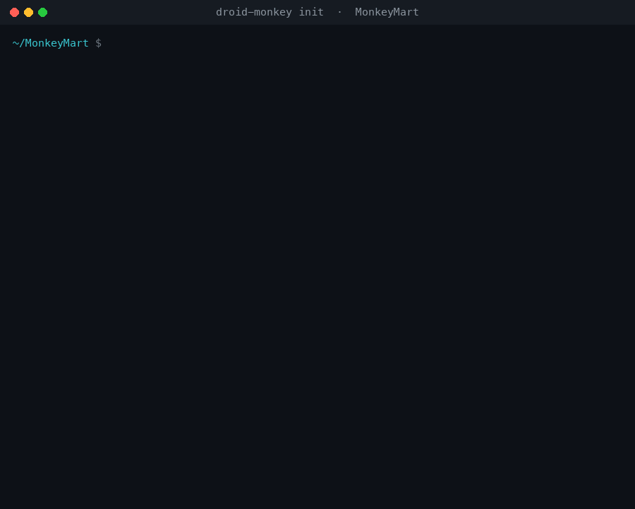
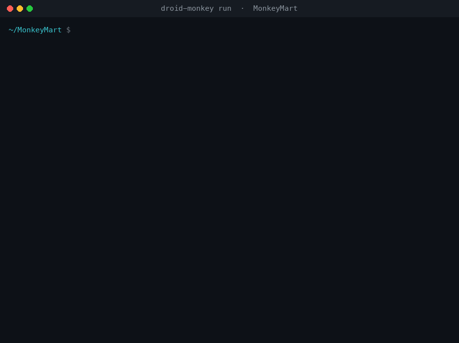
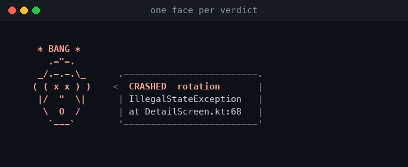
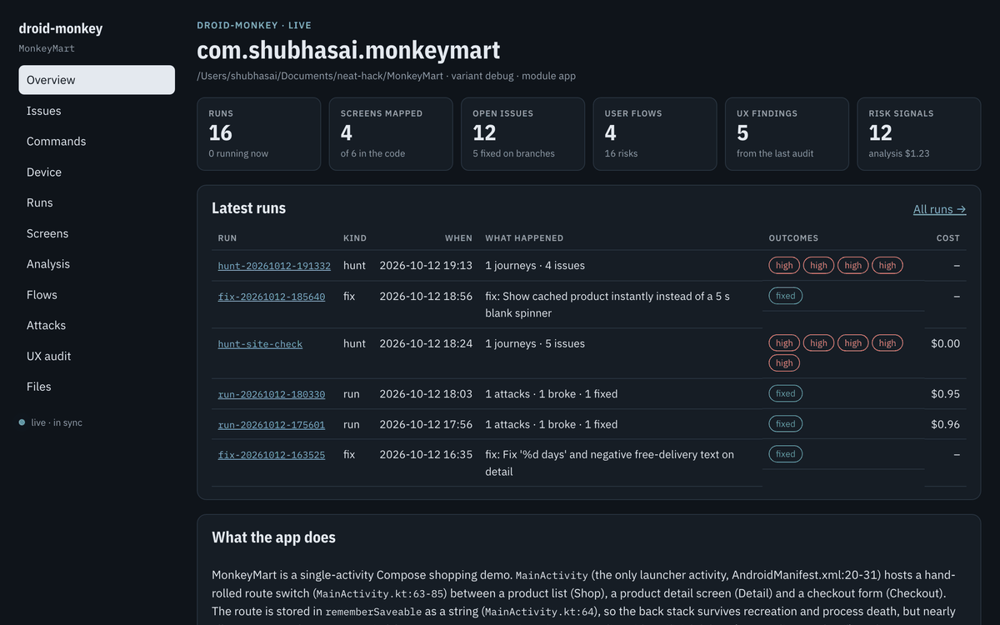
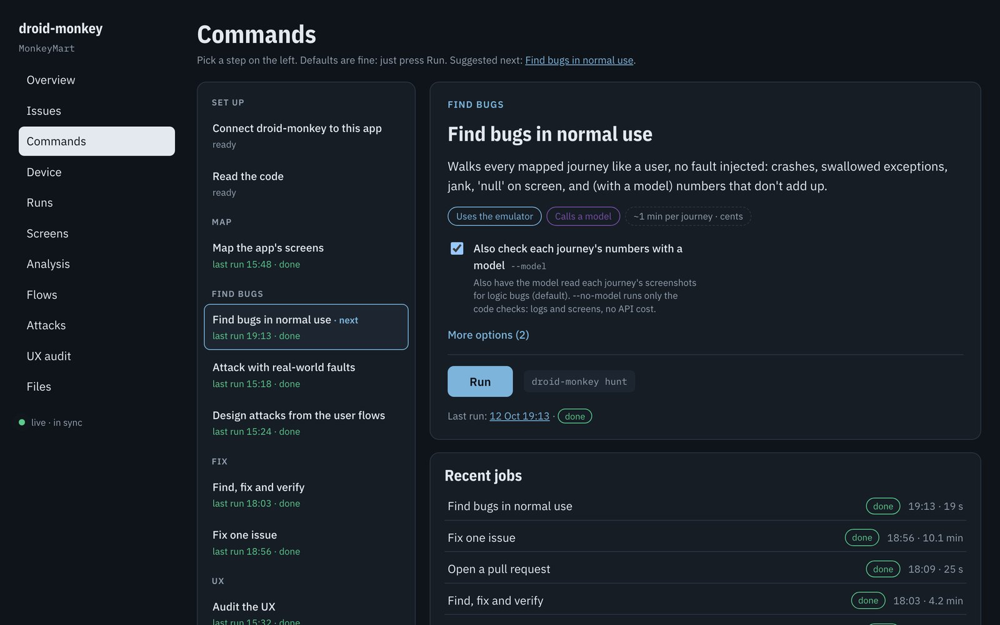
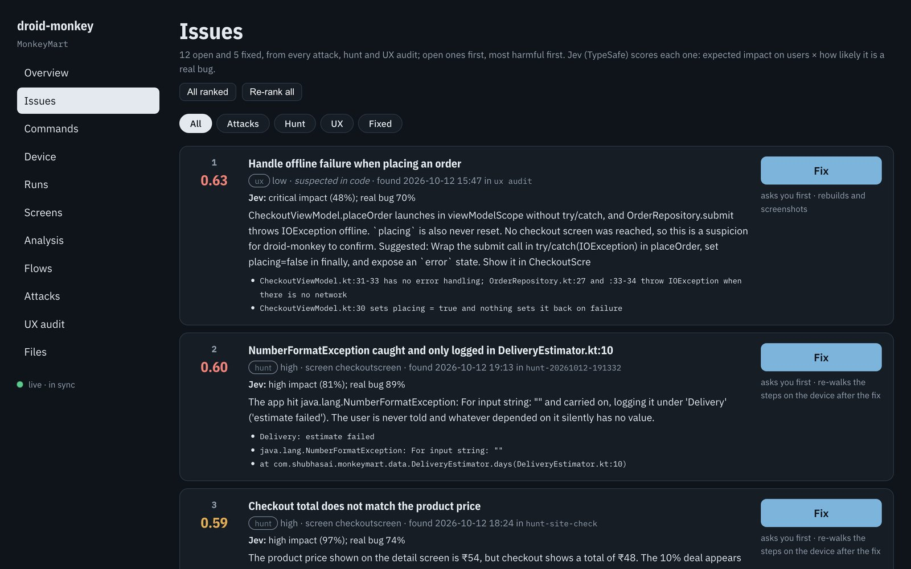

<div align="center">

# 🐒 Setting up droid-monkey

**From nothing to droid-monkey attacking your Android app in about 20 minutes**<br>
<sub>if you already have Android Studio · written for macOS, where droid-monkey is developed and tested · on Linux, set `ANDROID_HOME` and the same steps apply</sub>



<sub><code>droid-monkey init</code> checks everything below and tells you exactly what's missing.</sub>

</div>

---

## ⚡ The short version

Already have Android Studio, an AVD and Claude Code? Then this is all of it:

```bash
uv tool install git+https://github.com/shubhasai/droid-monkey
mkdir -p ~/.droid-monkey
echo "DROID_MONKEY_API_KEY=sk-ant-..." >> ~/.droid-monkey/.env
chmod 600 ~/.droid-monkey/.env
cd your-android-app
droid-monkey init       # fix anything it marks MISSING, then run it again
droid-monkey run
```

Everything else on this page is the long version of those lines, plus [troubleshooting](#-troubleshooting).

## Contents

1. [What you need](#1-what-you-need)
2. [Install droid-monkey](#2-install-droid-monkey)
3. [Android SDK and an emulator](#3-android-sdk-and-an-emulator)
4. [Keys](#4-keys)
5. [A coding agent](#5-a-coding-agent)
6. [Entire (recommended)](#6-entire-recommended)
7. [Optional extras](#7-optional-extras)
8. [Set up your app](#8-set-up-your-app)
9. [First run](#9-first-run)
10. [Using it from the dashboard](#10-using-it-from-the-dashboard)

Then: [Signed-in apps](#-signed-in-apps) · [Safety](#-safety) · [Troubleshooting](#-troubleshooting)

## 1. What you need

| | Need | Used for |
|---|---|---|
| Python 3.12+ and [uv](https://docs.astral.sh/uv/) | **required** | Installing and running droid-monkey |
| Android SDK: platform-tools (`adb`), the emulator, one AVD | **required** | Running the app, the attacks and the hunt |
| A JDK that your app's Gradle accepts | **required** | Building the app (Android Studio ships one) |
| An Anthropic API key | **required** | droid-monkey's own reasoning: plan, decide, diagnose, the hunt's journey review, the designer. Haiku 5.5 by default, a few cents per run |
| One coding agent: Claude Code, Codex, or the API key above | **required** | `analyze`, `explore` and the fixes |
| [Entire](https://entire.io) with its `graph` plugin | recommended | Checkpoints on every fix commit; the code graph the diagnoser searches |
| `gh`, logged in | optional | `droid-monkey pr` |
| A neatlogs API key | optional | Tracing every run |
| A TypeSafe API key | optional | Ranking issues by user impact (`issues`); severity is used without it |
| `shark-cli` (LeakCanary's analyser) | optional | Reference chains for memory leaks found by `low_memory` |

> [!NOTE]
> Perfetto's `trace_processor` and the fast screen reader (uiautomator2) come with droid-monkey. There's nothing to install for them, and **nothing to add to your app**: no SDK, no test code, no instrumentation.

## 2. Install droid-monkey

Install uv if you don't have it:

```bash
curl -LsSf https://astral.sh/uv/install.sh | sh
```

Then install droid-monkey as a command available everywhere:

```bash
uv tool install git+https://github.com/shubhasai/droid-monkey
```

Check it:

```bash
droid-monkey --version
```

<details>
<summary><b>From a clone instead</b> (to change droid-monkey itself)</summary>

```bash
git clone https://github.com/shubhasai/droid-monkey && cd droid-monkey && uv sync
```

Run it as `uv run droid-monkey ...` from the clone, or point it at an app with `--app-dir`.

- Tests: `uv run pytest`
- The terminal GIFs in these docs: `uv run python scripts/render_cli_gifs.py`

</details>

## 3. Android SDK and an emulator

1. Install [Android Studio](https://developer.android.com/studio). It brings the SDK, `adb`, the emulator and a JDK.
2. In **Device Manager**, create one virtual device and note its name, for example `Pixel_10`. A recent Pixel with a Google APIs image works well.
3. Make `adb` and `emulator` reachable. droid-monkey finds them in `~/Library/Android/sdk` on its own. For your own shell, and on Linux, add:

   ```bash
   export ANDROID_HOME="$HOME/Library/Android/sdk"
   export PATH="$ANDROID_HOME/platform-tools:$ANDROID_HOME/emulator:$PATH"
   ```

4. Check the device list:

   ```bash
   emulator -list-avds
   ```

You don't have to start the emulator yourself. If none is running, droid-monkey boots the AVD named in `monkey.yaml` (or the first one), health-checks it, and restarts it if it hangs.

> [!IMPORTANT]
> Physical phones aren't supported: the attacks need an emulator.

## 4. Keys

All keys live in **`~/.droid-monkey/.env`**, outside every repo. droid-monkey reads them itself, never exports them to your shell, and strips them from the coding agent's environment.

```bash
mkdir -p ~/.droid-monkey && touch ~/.droid-monkey/.env && chmod 600 ~/.droid-monkey/.env
```

Then open the file and add:

```bash
DROID_MONKEY_API_KEY=sk-ant-...      # required: Anthropic key for droid-monkey's own reasoning
NEATLOGS_API_KEY=...                 # optional: tracing
TYPESAFE_API_KEY=...                 # optional: ranking issues by user impact
```

> [!WARNING]
> Use `DROID_MONKEY_API_KEY`, **not** `ANTHROPIC_API_KEY`. Claude Code uses `ANTHROPIC_API_KEY` whenever it's set, which would move your Claude Code sessions from your plan to API billing.

Credentials for a test account go in the same file (see [Signed-in apps](#-signed-in-apps)).

## 5. A coding agent

droid-monkey uses one coding agent to read your code, drive the app while exploring, and make fixes. The default, `auto`, picks the first one that's set up, in this order:

| Agent | Set up | Notes |
|---|---|---|
| **Claude Code** (recommended) | Install from [claude.com/claude-code](https://claude.com/claude-code), then run `claude` once and log in | Uses your Claude plan. Entire checkpoints every fix |
| Codex | `npm install -g @openai/codex`, then `codex login` | Checkpoints with `entire agent add codex` |
| API agent | Nothing beyond `DROID_MONKEY_API_KEY` | droid-monkey's own tool loop on the Anthropic API |

To pick one explicitly, set `agent: claude | codex | api` in `monkey.yaml`, or pass `--agent` on a command.

## 6. Entire (recommended)

```bash
brew install --cask entireio/tap/entire
entire login
entire plugin install graph
```

Then, once per app repo:

```bash
entire enable --agent claude-code
```

With Entire enabled, every fix commit droid-monkey makes carries an `Entire-Checkpoint` trailer that links it to the recorded coding session, and the diagnoser searches Entire's code graph. `git push` sends the checkpoints too.

## 7. Optional extras

<details>
<summary><b>GitHub CLI</b>, for <code>droid-monkey pr</code></summary>

```bash
brew install gh && gh auth login
```

</details>

<details>
<summary><b>shark-cli</b>, for memory-leak reference chains</summary>

```bash
brew install leakcanary-shark
```

You can also unpack its release zip into `~/.droid-monkey/tools/`. It's a Java program: droid-monkey runs it with `JAVA_HOME`, or with Android Studio's JDK when that's unset.

</details>

## 8. Set up your app

From the root of your Android app's repo (where `gradlew` is):

```bash
droid-monkey init
```

`init` detects the app module, its `applicationId`, the build variant, an AVD and a JDK your Gradle can run on, and writes **`monkey.yaml`**. It also creates **`.droid-monkey/`**, where everything droid-monkey produces goes (runs are git-ignored automatically). Then it checks everything above, as in the GIF at the top of this page.

Fix anything marked `MISSING` and run `droid-monkey init` again. It keeps your `monkey.yaml`, and `--force` rewrites it.

### monkey.yaml

Everything app-specific lives here: droid-monkey's code knows nothing about any particular app. `init` fills in the first block, and the rest is optional.

```yaml
package: com.example.shop        # applicationId
module: app
variant: debug
avd: Pixel_10
# java_home: /Library/Java/...    # only when your Gradle needs an older JDK; init sets it

# optional
agent: auto                       # auto | claude | codex | api
screens_per_attack: 2             # each built-in attack runs on its best N screens
explore_minutes: 10               # agent exploration stops here and keeps what it mapped
explore_max_screens: 60
live_backend: true                # see "Safety" below
allow_actions: []                 # labels that are safe to tap, e.g. ["Place order"] on a fake backend
llm:
  provider: anthropic             # or openai_compatible (with base_url)
  model: claude-haiku-5-5
```

## 9. First run

```bash
droid-monkey analyze                      # read the code: ANALYSIS.md and the user flows worth testing
droid-monkey explore                      # drive the app: the screen map, with the files behind each screen
droid-monkey hunt                         # bugs in normal use, no fault injected
droid-monkey attack builtin --diagnose    # real-world faults: what breaks, and the suggested fix
droid-monkey run                          # the full loop; asks you before every fix
droid-monkey dashboard                    # a live page over everything in .droid-monkey/
```

This is what `run` looks like. It's a real MonkeyMart run, with log lines shortened. The first fix doesn't hold up on the device, so droid-monkey revises its diagnosis, asks again, and only commits once the replay survives:

<p align="center"></p>

droid-monkey **never changes your code without your yes**. Every fix shows the issue, the evidence measured on the device, the root cause and the suggested change, and then waits. Fixes go on a `droid-monkey/<run-id>` branch with one commit per fix, and you're put back on your own branch at the end. `--auto-fix` skips the question, for CI.

Prefer a browser? `droid-monkey dashboard` runs all of this from a page ([step 10](#10-using-it-from-the-dashboard)).

### Reading the monkey

Every verdict is measured on the device by code, and the monkey makes a face for each one:

<p align="center"></p>

| Face | Verdict | Means |
|---|---|---|
| `(x_x)` | `crashed` | The app crashed during the attack |
| `(o.O)` | `lost_state` | The app came back without what the user typed, or on the wrong screen |
| `(-.-)` | `no_feedback` | Something failed and the app showed nothing |
| `(;_;)` | `leaked` | Screens stay in memory after a forced GC |
| `(*_*)` | `froze` | A frame took over 700 ms |
| `(@_@)` | `anr` | Android declared the app not responding |
| `(u_u)` | `slow_start` | Median cold start ≥ 5 s or hot start ≥ 1.5 s |
| `(^.^)` | `survived` | Nothing broke |
| `(^o^)` | `fixed` | The identical attack survived on the fixed build, and the new test passed |

## 10. Using it from the dashboard

Prefer clicking to typing? Everything above also works from the browser:

```bash
droid-monkey dashboard          # http://127.0.0.1:8787  (--port to change it, --open to open it)
```

<p align="center"></p>
<p align="center"><sub>The real dashboard on MonkeyMart: overview → Commands → a run's output → the run report → Issues → Screens</sub></p>

**Run any command.** Open **Commands** and pick a step on the left: set up, map, find bugs, fix, UX, reports. The steps are in the order you'd run them, and the next one is suggested. Each form is built from the CLI itself, so every option is there with its default. Tags tell you up front whether a step uses the emulator, calls a model, changes code (it asks you first) or publishes to GitHub, and roughly how long it takes. Press **Run**.

<p align="center"></p>

**Watch it and answer it.** The job page streams the same output as the terminal, monkeys included, with the emulator's screen live beside it. When droid-monkey asks **"Fix it?"**, the question appears above the output with **Yes**, **No**, **All remaining** and **Enter** buttons, or a box to type an answer. **Stop** sends Ctrl+C, just like the terminal. Jobs keep running if you close the tab, and the history stays under **Recent jobs**.

**Fix from the ranked list.** **Issues** puts everything that attacks, hunts and UX audits found into one list, most harmful first, with each issue's evidence and score. **Fix** on any issue asks you first, makes the fix, and re-checks it on the device.

<p align="center"></p>

**Ship it.** A run's page shows its branch, its report (resilience score, recordings, charts, the diff) and an **Open PR** button.

**What else is there:**

| Page | What it shows |
|---|---|
| **Overview** | Runs, mapped screens, open issues, user flows, UX findings and the app summary at a glance |
| **Device** | The emulator's screen, live |
| **Runs** | Every run and fix with its evidence and report |
| **Screens** | The screen map: each screen's screenshot and attention heatmap, how to reach it, and the files behind it |
| **Analysis** · **Flows** · **Attacks** | The code analysis, the user flows with their risks, and the saved attacks |
| **UX audit** | The full UX audit report, and `UX_AUDIT.md` |
| **Files** | Everything in `.droid-monkey/` |

The page follows `.droid-monkey/`: when a run started from the terminal writes something, the open page refreshes too. So you can run from the terminal and watch in the browser, or the other way round.

> [!NOTE]
> The dashboard listens on `127.0.0.1` only. Starting, answering or stopping a job needs a token that only the dashboard's own pages carry, and requests from other sites are refused, so no other web page can run commands on your machine. One job runs at a time because jobs share the emulator, and **Open PR** asks you to confirm before it pushes anything.

## 🔐 Signed-in apps

To reach screens behind a login, give droid-monkey a **test account**. It signs in after every launch:

```yaml
entry_steps: ["tap text:Log in", "type username=${DM_TEST_USER}", "type password=${DM_TEST_PASSWORD}", "tap login_button"]
entry_check: "text:Your orders"   # something only a signed-in user sees; the run stops if sign-in failed
```

Put `DM_TEST_USER` and `DM_TEST_PASSWORD` in `~/.droid-monkey/.env`, never in `monkey.yaml`.

## 🛡 Safety

- With `live_backend: true` (the default), droid-monkey refuses to tap anything that would act on a real backend: sign up, log in, post, publish, pay or place an order. Set `live_backend: false` only for a build that talks to a test or fake backend, or list specific safe labels in `allow_actions`.
- While signed in, it never taps Log out or Sign out.
- The fixing agent may only edit the app's sources (`<module>/src`). It has no shell, can't read docs or git history, and can't change build files.

## 🩹 Troubleshooting

| Symptom | Fix |
|---|---|
| `adb not found` | Install Android platform-tools, or set `ANDROID_HOME` |
| `no monkey.yaml in …` | Run `droid-monkey init` in the app repo's root first |
| The build fails with a Java or Gradle version error | Set `java_home:` in `monkey.yaml` to a JDK 17 or 21 (`/usr/libexec/java_home -V` lists them) |
| `refused to tap 'Buy now' …` | The safety guard. On a fake backend, add the label to `allow_actions` or set `live_backend: false` |
| `the device could not install the test (… MB free)` | The emulator is out of storage: wipe its data in Device Manager, or give the AVD a bigger disk |
| A fix is suggested but not applied when piping output | Approval needs a terminal: run interactively, or pass `--auto-fix` |
| `DROID_MONKEY_API_KEY is not set` | Add it to `~/.droid-monkey/.env` ([step 4](#4-keys)) |
| `no coding agent available` | Set up one of the agents in [step 5](#5-a-coding-agent) |
| A run was killed | `droid-monkey run --resume <run-id>` continues without redoing finished attacks |

---

<p align="center">Set up? Back to the <a href="README.md">README</a> for what droid-monkey found in Google's sample, MonkeyMart and Wikipedia.</p>
