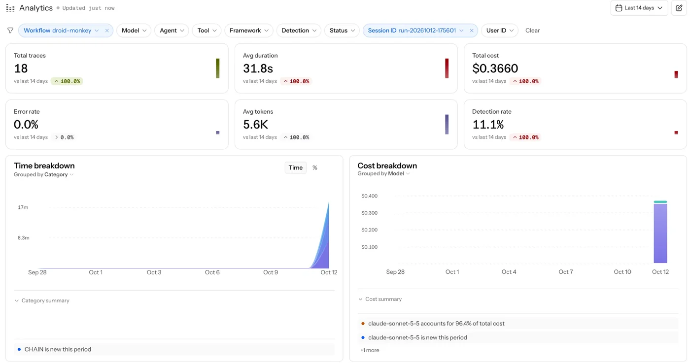
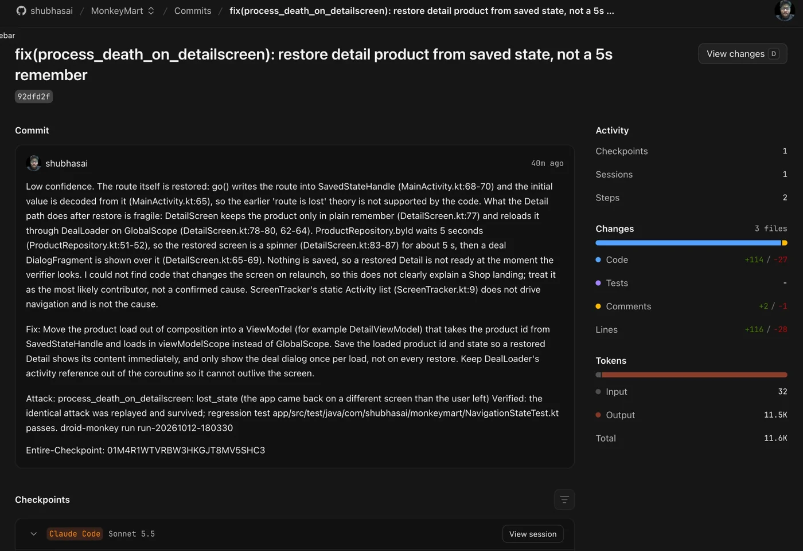
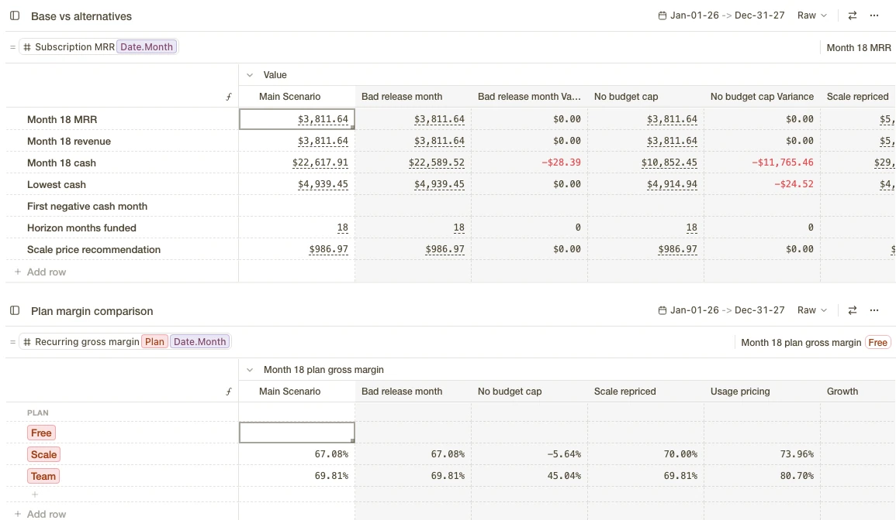
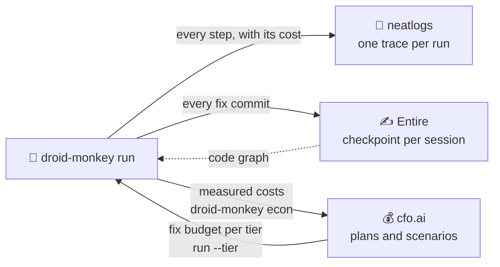

# 🧾 Evidence

**How droid-monkey uses neatlogs, Entire and cfo.ai, and what each one changed**

The demo covers each tool's architecture, implementation, runtime, reasoning and result.

---

Each tool has one job in droid-monkey's loop:

<table>
<tr>
<td valign="top" width="33%">

### 🔭 [neatlogs](neatlogs.md)
**Watches what the agent does.**

Every run is one trace, with the exact cost of every step, including the Claude Code sessions droid-monkey starts.

**Result:** it caught a silent failure the logs missed, which is now fixed and tested.

</td>
<td valign="top" width="33%">

### ✍️ [Entire](entire.md)
**Records who wrote each line.**

Every fix commit links to the Claude Code session that made it. The diagnoser can also search Entire's [code graph](entire-graph.md).

**Result:** 35 checkpoints on MonkeyMart and 17 on droid-monkey itself.

</td>
<td valign="top" width="33%">

### 💰 [cfo.ai](cfo-ai.md)
**Decides how much the agent may spend.**

The business plan is built from measured costs, and it sets a fix budget that `run --tier` enforces.

**Result:** with no cap, Scale's margin is **−5.6%**; with the cap, **67.1%**.

</td>
</tr>
<tr>
<td></td>
<td></td>
<td></td>
</tr>
</table>

## How they fit together

<b>The full matrix</b>: architecture, implementation, runtime, reasoning and result for each tool

| | neatlogs | Entire | cfo.ai |
|---|---|---|---|
| **Architecture** | One trace per run: LangGraph nodes, every API call and every Claude Code session as spans. The app is the end user and the run id is the session | `entire enable` on droid-monkey and MonkeyMart; checkpoint refs pushed to GitHub; `entire graph search` as a diagnoser tool | `droid-monkey econ` → `business/drivers.csv` → a cfo.ai model built by Ari → `unit_economics.json` → `run --tier` |
| **Implementation** | [`tracing.py`](../src/droid_monkey/tracing.py): `neatlogs.init` with the langgraph, langchain and anthropic instrumentations; `ClaudeCodeSpan` for `claude -p`; WORKFLOW, TOOL and GUARDRAIL spans | Commit trailers `Entire-Checkpoint: <id>`; [`codetools.py`](../src/droid_monkey/codetools.py) `graph_search`; [`init_cmd.py`](../src/droid_monkey/init_cmd.py) checks Entire and its plugin | [`econ.py`](../src/droid_monkey/econ.py) and the `--tier` budget check in [`loop.py`](../src/droid_monkey/loop.py) |
| **Runtime** | Spans carry exact tokens and cost (Claude Code's own report, or per-call prices for API calls); a failed session sets `claude_code.error` and ERROR status | Each droid-monkey fix commit records the coding agent's session as a checkpoint | Each failure-handling decision first checks the run's spend against the tier budget (a `budget` GUARDRAIL span) |
| **Reasoning** | droid-monkey runs other agents in separate processes. Only a trace shows the whole run and what it cost | A reviewer can see why a line changed and which agent session wrote it, not only the diff | Fixes are where the money goes ($0.56 an attempt, attacks $0), so the plan has to cap fix spend |
| **Result** | Caught a silent failure the logs missed: the empty-explore incident, now fixed ([neatlogs.md](neatlogs.md)) | 35 checkpoints on MonkeyMart (3 of them from droid-monkey fixes made on Oct 12, the first in PR #2) and 17 on droid-monkey itself ([entire.md](entire.md)) | With no cap, Scale's margin is −5.6%; with the cap, 67.1%. Scale needs $986.97 to cover normal fix demand ([cfo-ai.md](cfo-ai.md)) |

## In this folder

| File | What's in it |
|---|---|
| [**neatlogs.md**](neatlogs.md) | What gets traced, the incident it caught, before/after runs, and the recovery run step by step |
| [**entire.md**](entire.md) | How checkpoints work, every fix commit with its checkpoint, and how to check them yourself |
| [**entire-graph.md**](entire-graph.md) | Real output of Entire's code graph on MonkeyMart's 6 bugs: did it point at the bug? |
| [**cfo-ai.md**](cfo-ai.md) | The measure → model → enforce loop, the measured inputs and the six scenarios |
| [**building-in-public.md**](building-in-public.md) | The posts on X during the hackathon, each linked to what it shows |

Back to the <a href="../README.md">README</a>

