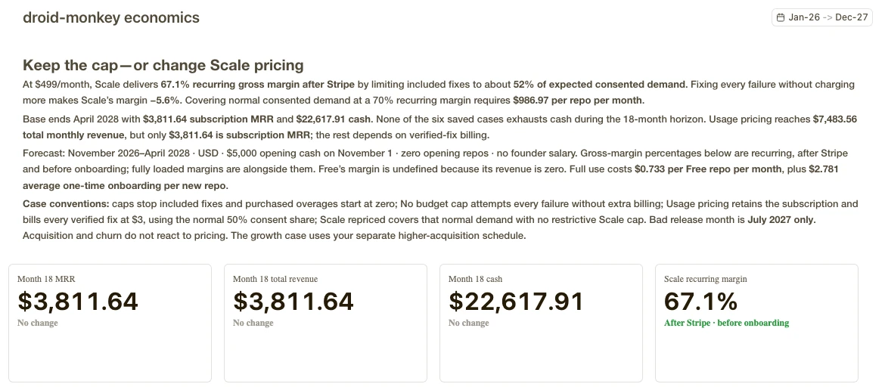
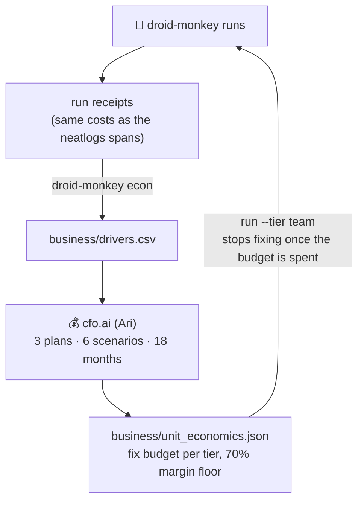

<sub>[Evidence](README.md) · [neatlogs](neatlogs.md) · [Entire](entire.md) · [code graph](entire-graph.md) · **cfo.ai** · [posts on X](building-in-public.md)</sub>

# 💰 cfo.ai: the business plan sets what the agent may spend

> [!TIP]
> **In short:** attacks cost nothing in model spend, and fixes are where the money goes. The plan built in cfo.ai from droid-monkey's own measured costs shows that **a fix budget is what keeps it profitable**: without one, the Scale plan loses money (**−5.6%** margin). droid-monkey enforces that budget on every run with `--tier`.

**[Model (public, read-only)](https://cfo.ai/s/dcL7ulePdgkkZNCB)** · **[Full plan](../docs/cfo-plan.md)**

<table>
<tr>
<td width="50%"></td>
<td width="50%"></td>
</tr>
<tr>
<td><sub><b>The model's conclusion:</b> keep the fix cap, or reprice Scale to $986.97</sub></td>
<td><sub><b>The scenarios side by side:</b> with no fix budget, Scale's margin drops to −5.64%</sub></td>
</tr>
</table>

## The loop



1. **Measure.** This command wrote [`business/drivers.csv`](../business/drivers.csv):

   ```bash
   droid-monkey econ --app-dir ../MonkeyMart --app-dir ../wikipedia --app-dir ../architecture-samples
   ```

   Each row is either measured (with the run it came from) or an assumption (marked `measured=no`).
2. **Model.** In cfo.ai, Ari built the model from `drivers.csv` and [`inputs.json`](../business/inputs.json), using the prompt in [`business/cfo-prompt.md`](../business/cfo-prompt.md): three plans, Stripe fees, $5,000 opening cash, 18 months and six scenarios.
3. **Enforce.** The 70% margin floor sets each tier's fix budget per run:

   > price ÷ runs × (1 − floor) − compute − planning

   `run --tier` loads it. Once a run has spent its budget, droid-monkey keeps attacking but stops fixing, and each check is a `budget` GUARDRAIL span in neatlogs. Code: [`econ.py`](../src/droid_monkey/econ.py), `Loop.within_budget` in [`loop.py`](../src/droid_monkey/loop.py), and tests in `tests/test_econ.py`.

## Measured inputs

| Driver | Value |
|---|---|
| Attack | **$0** model spend, 31 s mean (74 attacks) |
| Fix attempt | **$0.56** mean, $0.81 p90 (4 attempts) |
| Verified fix | **$1.12** (2 verified) |
| Setup per repo | $1.4 to $4.9 (code analysis + UX audit) |
| CI compute per run | about $0.07 (**assumption:** $0.008 per runner minute) |

## What cfo.ai showed

Read from the model:

| Scenario | Scale margin | Team margin | Month-18 MRR | Month-18 cash |
|---|---|---|---|---|
| Base | 67.1% | 69.8% | $3,812 | $22,618 |
| Bad release month | 67.1% | 69.8% | $3,812 | $22,590 |
| **No budget cap** | **−5.6%** | 45.0% | $3,812 | $10,852 |
| Scale repriced ($986.97) | 70.0% | 69.8% | $5,522 | $29,732 |
| Usage pricing ($3 per verified fix) | 74.0% | 80.7% | $3,812 (revenue $7,484) | $44,764 |
| Growth | 67.1% | 69.8% | $9,681 | $62,785 |

- 🛑 **The fix budget is what keeps droid-monkey profitable.** Without it, Scale loses money and month-18 cash halves.
- 📉 **Scale at $499 covers about 52% of expected fix demand.** Covering all of it at a 70% margin takes **$986.97 per repo per month**.
- ✅ **No scenario runs out of cash** within 18 months.

> [!CAUTION]
> The sample is small (4 fix attempts), and the 36% attack failure rate comes from test apps with planted bugs. Rerun `droid-monkey econ` as more runs come in, then refresh the model in cfo.ai.
