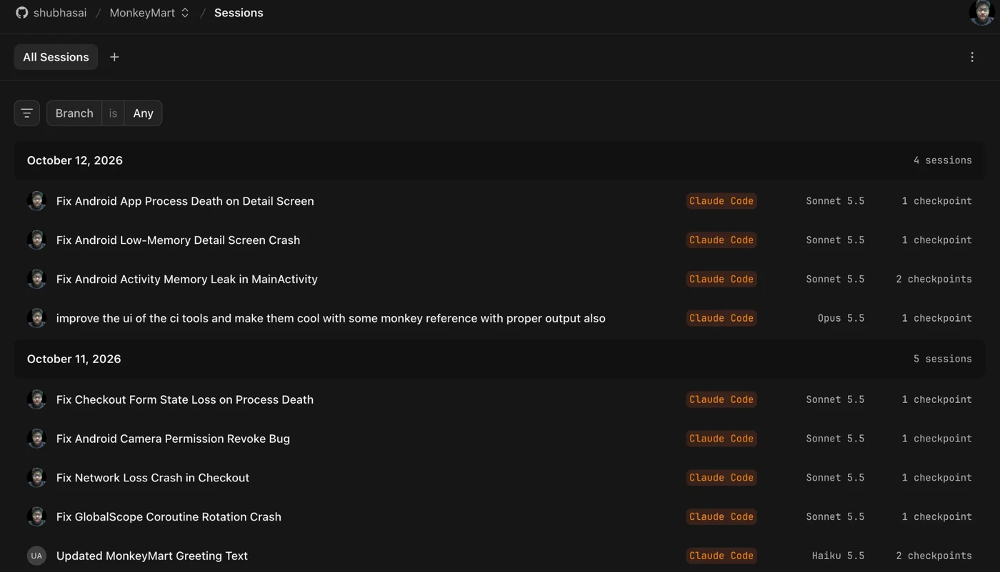
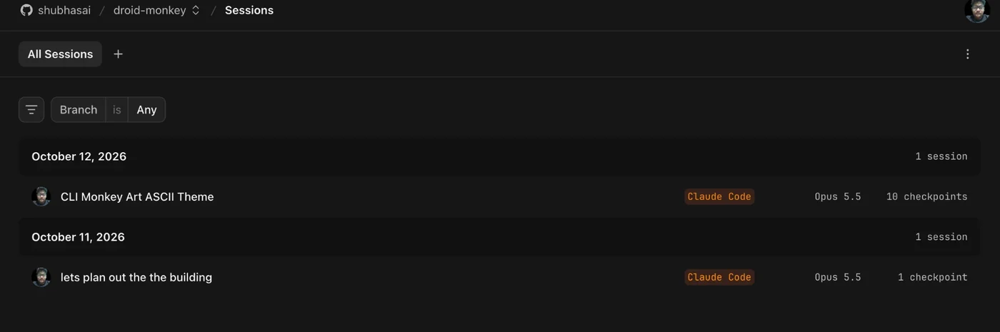

<sub>[Evidence](README.md) · [neatlogs](neatlogs.md) · **Entire** · [code graph](entire-graph.md) · [cfo.ai](cfo-ai.md) · [posts on X](building-in-public.md)</sub>

# ✍️ Entire: the session behind every fix

> [!TIP]
> **In short:** every fix droid-monkey commits carries an `Entire-Checkpoint` trailer that links it to the Claude Code session that wrote it. For code written by an agent, that answers "why did this line change, and who changed it". MonkeyMart has **35 checkpoints**, and droid-monkey itself has **17**.

<p align="center"></p>
<p align="center"><sub>Fix commit <code>92dfd2f</code> on entire.io: droid-monkey's diagnosis and verification in the message, and the Claude Code session that wrote it (1 checkpoint, 11.6K tokens)</sub></p>

## How droid-monkey uses it

| Use | How | Code |
|---|---|---|
| **Checkpoints on fixes** | Entire is enabled on the app repo (MonkeyMart). droid-monkey's coding agent runs as a Claude Code session in that repo, so Entire records the session. Every fix commit droid-monkey makes carries an `Entire-Checkpoint: <id>` trailer linking it to that session | [`tools/git.py`](../src/droid_monkey/tools/git.py) `commit` returns the checkpoint; run reports, fix records and PR bodies show it |
| **Code graph for diagnosis** | The diagnoser has a `graph_search` tool that runs `entire graph search --query … --repo <app> --format json` and keeps only the app's own source files. On MonkeyMart's 6 bugs it put the bug's lines in the top 3 for 4 of them, and the right file for all 6 ([entire-graph.md](entire-graph.md)). In the runs traced in neatlogs, the diagnoser chose `read_code` and `search_code` instead | [`codetools.py`](../src/droid_monkey/codetools.py) `graph_search` |
| **Setup check** | `droid-monkey init` checks that the Entire CLI and its plugin are installed and says how to install them | [`init_cmd.py`](../src/droid_monkey/init_cmd.py) |
| **Proof of authorship** | Entire is enabled on droid-monkey itself, so the Claude Code sessions that built it during the hackathon are recorded as checkpoints | this repo |

<table>
<tr>
<td width="50%"></td>
<td width="50%"></td>
</tr>
<tr>
<td><sub><b>MonkeyMart's sessions:</b> each fix droid-monkey made is a recorded Claude Code session with its checkpoints</sub></td>
<td><sub><b>droid-monkey's own build sessions</b>, checkpointed the same way</sub></td>
</tr>
</table>

## Checkpoints as of Oct 12, 2026

**MonkeyMart** (the sample app) has 35 checkpoint refs pushed to GitHub, and 32 commits carry an `Entire-Checkpoint` trailer (counted at 21:35 IST on Oct 12).

These are the fixes droid-monkey made, each checked on the device before it was committed:

| Commit | Fix | How it was checked | Checkpoint | Where |
|---|---|---|---|---|
| `709354b` | **Low memory** on the detail screen: cancel the deal load with the screen, not `GlobalScope` | The same attack replayed and survived; `DealLoaderTest` passes | `01M4QVMZ3EAQ2ZPGG3XK5BXW3Z` | [PR #2](https://github.com/shubhasai/MonkeyMart/pull/2) |
| `d054227` | **A negative amount of money** shown ("Add ₹-5 more") | The hunt re-walked its steps on the device: gone | `01M4QVZ7P91WQM9G0B9N4KYM28` | branch `droid-monkey/fix-76c4a09085` (local) |
| `e1272a4` | **"Ships in %d days"** and the free-delivery check | Built | `01M4QWMV30S2D0CHZJ5288H5EZ` | branch `droid-monkey/fix-b93c14b363` (local) |
| `a26df3b` | **Rotation**: deal popup coroutine tied to the lifecycle | The attack replayed and survived; regression test | `01M4NR3068C3CGV32XTSWM30Z7` | [PR #1](https://github.com/shubhasai/MonkeyMart/pull/1) |
| `af6bd25` | **Network loss**: checkout submit failures caught | Same | `01M4NR7N65EDGMKSJK49QR5QHH` | PR #1 |
| `0494031` | **Revoked permission**: camera permission checked when it's used | Same | `01M4NRBPHNPTMHDQS6QXRN3415` | PR #1 |
| `92d9d45` | **Process death**: checkout form kept in `SavedStateHandle` | Same | `01M4NRG6F31PQSZTN592TZZC3X` | PR #1 |

**droid-monkey** (this repo) has 17 checkpoint refs pushed to GitHub, and 18 commits on `main` carry a checkpoint trailer. Examples are `a84da6f` (the live device stream), `24eeace` (issue ranking and `fix`) and `0cdc1a2` (`hunt`).

## Check it yourself

The checkpoint trailer on a fix commit:

```bash
git -C MonkeyMart log -1 --format='%h %s%n%(trailers)' 709354b
```

The checkpoint refs pushed to GitHub:

```bash
git ls-remote https://github.com/shubhasai/MonkeyMart 'refs/entire/checkpoints/*'
```

Each pushed commit also has a page on entire.io: `https://entire.io/gh/shubhasai/MonkeyMart/commit/<full sha>`.
