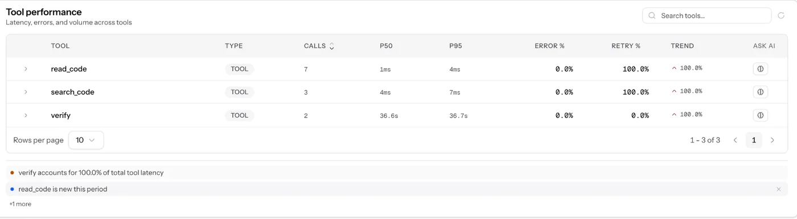
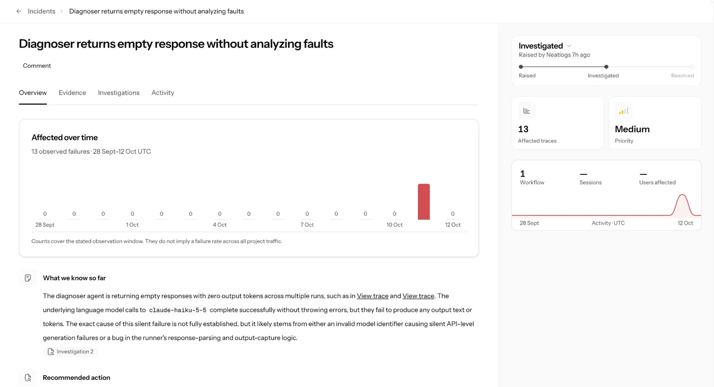

<sub>[Evidence](README.md) · **neatlogs** · [Entire](entire.md) · [code graph](entire-graph.md) · [cfo.ai](cfo-ai.md) · [posts on X](building-in-public.md)</sub>

# 🔭 neatlogs: one trace per run, with the cost of every step

> [!TIP]
> **In short:** droid-monkey is an agent that drives other agents, mostly in separate `claude -p` processes, so its own logs only see what each one reports back. neatlogs puts the whole run in one trace. It caught a failure the logs missed: [the empty explore session](#how-it-helped-a-silent-failure-the-logs-missed).

<p align="center"></p>
<p align="center"><sub>The recovery run (session <code>run-20261012-175601</code>) in neatlogs: 18 traces, 0 errors, time and cost by step and model</sub></p>

## What gets traced

| Where | What | Code |
|---|---|---|
| **Setup** | `neatlogs.init(workflow_name="droid-monkey", instrumentations=["langgraph", "langchain", "anthropic"])`, tagged `run:<id>`, `app:<package>` and `mode:<droid-monkey or naive>` | [`tracing.py`](../src/droid_monkey/tracing.py) `init`; [`loop.py`](../src/droid_monkey/loop.py) `run` |
| **Who and which run** | `neatlogs.identify(end_user_id=<app package>, session_id=<run id>)`: the app is the end user and each run is a session | `loop.py` `run` |
| **The run** | A `droid-monkey run` WORKFLOW span. LangGraph instrumentation adds every node: setup, plan, pick, attack, decide, diagnose, approve, fix, verify, commit, give_up, report | `loop.py` |
| **droid-monkey's own model calls** | LangChain/Anthropic LLM spans. droid-monkey copies the token counts onto the `neatlogs.llm.*` attributes and adds the cost from Anthropic's prices, so neatlogs shows real spend instead of $0 | `tracing.py` `_price_api_calls` |
| **Claude Code sessions** | One LLM span per `claude -p` (`claude-code.explore`, `claude-code.fix.<id>`, …) with Claude Code's exact tokens, cache tokens, cost, turns and duration, plus the prompt and answer | `tracing.py` `ClaudeCodeSpan`; [`tools/claude_code.py`](../src/droid_monkey/tools/claude_code.py) |
| **Failures** | A failed or empty session sets `claude_code.error` and ERROR status, so it shows up as a named failure | `tracing.py`, `tools/claude_code.py` `failure` |
| **Steps** | WORKFLOW spans `diagnoser`, `hunt` and `attack_designer:<source>`; a TOOL span `verify`; an AGENT span for the API coding agent | `diagnoser.py`, `hunt.py`, `designer.py`, `verifier.py`, `agents.py` |
| **Budget** | A `budget` GUARDRAIL span on each check against the cfo.ai plan's fix budget (`run --tier`), with the run's spend, the budget and the tier | `loop.py` `within_budget` |

<p align="center"></p>
<p align="center"><sub>Tool performance: the diagnoser's code tools (<code>read_code</code>, <code>search_code</code>) and the device verification, timed per call</sub></p>

## How it helped: a silent failure the logs missed

On Oct 12, neatlogs raised the incident **"Explorer returns empty response without mapping screens"**:
- incident `981cb137-9c13-4a66-b420-15ec3649f224`, medium priority;
- from trace `298e6539fac684793ec2e36284fe3c99`.

The explore session had made no tool calls, and it ended with an empty answer and zero output tokens.

droid-monkey's own logs showed no error for it, and the only traceback in that day's job logs was an unrelated device error. **As far as droid-monkey could tell, the session had succeeded.**

**The trace pointed at the cause.** An empty LLM span with no tool calls meant the agent had stopped without touching the device. The code had two gaps:
1. An empty or errored `claude -p` result was treated as a success, and `explore` never checked it.
2. If an earlier `screen-map.json` was on disk, `explore` returned it as if this run had made it.

**The fix** (commit `08fdebd`):
- ✅ Empty or errored sessions now fail with a reason, set on the span as `claude_code.error` with ERROR status. This applies to every Claude Code session.
- ✅ `explore` retries once when nothing was recorded, then stops and says why.
- ✅ A map counts only if this run wrote screens to it.
- ✅ `tests/test_empty_sessions.py` covers all of it.

<p align="center"></p>
<p align="center"><sub>Incidents are raised by neatlogs on its own. This one is a different incident: diagnoser sessions that returned nothing, in 13 traces</sub></p>

## Before and after an improvement, in neatlogs

The same 4 attacks on MonkeyMart, from the same base:
- **v1**, with no diagnosis;
- **v4**, after three rounds of improvements (diagnosis, a compile tool for the coder, JVM-first test plans), each made from the previous run's data.

Each run is one neatlogs session.

| | Before: v1, no diagnosis | After: v4, diagnosis + JVM-first test plans |
|---|---|---|
| neatlogs session | [`cmp-v1-naive`](https://app.neatlogs.com/analytics?orgId=45231b97-af94-485d-86e4-33372d00e625&projectId=88c2c7bb-fa0a-40ef-973f-d951070b8f3b&start=2026-09-28T13:44:14.626Z&end=2026-10-12T13:44:14.626Z&granularity=auto&f=session_id:in:cmp-v1-naive) | [`cmp-v4-test-plan`](https://app.neatlogs.com/analytics?orgId=45231b97-af94-485d-86e4-33372d00e625&projectId=88c2c7bb-fa0a-40ef-973f-d951070b8f3b&start=2026-09-28T13:44:14.626Z&end=2026-10-12T13:44:14.626Z&granularity=auto&f=session_id:in:cmp-v4-test-plan) |
| Duration (neatlogs) | 8.1 min | 8.9 min |
| Claude Code fix sessions (traced locally) | **$1.28**, 575k tokens over 4 sessions | **$1.27**, 498k tokens over 4 sessions |
| Fixed | 4/4 | **4/4, all first try** |

**What changed:** in v4, the diagnoser reads the code (`read_code`, `search_code`) before the coder starts. That diagnosis is what lets the coder fix each bug on the first try, with 13% fewer tokens.

> [!NOTE]
> **Claude Code costs were traced locally in these runs.** In these two runs, and in the recovery run below, neatlogs recorded droid-monkey's own calls but not the Claude Code fix sessions as spans. droid-monkey records each session's tokens and cost locally, from Claude Code's own report, in the run receipt. Entire's checkpoint for each fix session gives the same token counts (`entire checkpoint tokens <id>`). This is also why the recovery run shows $0.366 in neatlogs against $0.95 in its receipt: the receipt includes the Claude Code sessions.

<details>
<summary><b>Tokens per fix session</b>, with their Entire checkpoints</summary>

| Fix | v1 session (checkpoint) | v4 session (checkpoint) |
|---|---|---|
| rotation | 159.4k (`01M4NNS9…`) | 158.2k (`01M4NR30…`) |
| network_loss | 106.7k (`01M4NNXJ…`) | 83.0k (`01M4NR7N…`) |
| permission_revoke | 132.4k (`01M4NP1B…`) | 104.1k (`01M4NRBP…`) |
| process_death | 176.6k (`01M4NP5B…`) | 152.3k (`01M4NRG6…`) |
| **Total** | **575.1k** | **497.6k** |

</details>

## A failed action and the recovery path

Run [`run-20261012-175601`](https://app.neatlogs.com/analytics?orgId=45231b97-af94-485d-86e4-33372d00e625&projectId=88c2c7bb-fa0a-40ef-973f-d951070b8f3b&start=2026-09-28T13:44:14.626Z&end=2026-10-12T13:44:14.626Z&granularity=auto&f=session_id:in:run-20261012-175601) on MonkeyMart, started with:

```bash
droid-monkey run --attacks low_memory_on_detailscreen --fail-first-fix
```

> [!IMPORTANT]
> `--fail-first-fix` reports the first verified fix as failed, so the recovery path runs on demand.

| # | Step | What happened |
|---|---|---|
| 1 | **Attack** | Low memory on the detail screen. The app **crashed** with `IllegalStateException` at `DealLoader.load` (`DetailScreen.kt:68`) |
| 2 | **Diagnose → approve (y) → fix 1** | Claude Code changed `ScreenTracker.kt` and `DetailScreen.kt` and added `ScreenTrackerTest` (38 s, $0.61) |
| 3 | **Verify** ❌ | It passed, but `--fail-first-fix` reported it as failed. **This is the failed action** |
| 4 | **Decide: retry** | The failure note goes back into a **revised diagnosis**. It found that the first fix kept the same design (the Activity's FragmentManager still used from a coroutine that waits 5 s), and proposed taking the Activity out of the load path entirely, with the deal shown in a Compose dialog |
| 5 | **Approve (y) → fix 2 → verify** ✅ | 30 s, $0.34. **FIXED**: the replay survived and the test passed |
| 6 | **Commit** | `bd33eafb` on `droid-monkey/run-20261012-175601`, Entire checkpoint `01M4R1HD564JVD54BT1969WD6H`. Resilience 100/100 |

The whole run took **5.4 min**. Model spend was $0.013 on API calls (planning, decisions, 2 diagnoses) and $0.94 on Claude Code sessions (2 fixes).

**In neatlogs:** 18 traces, a 0.0% error rate and $0.366 traced, 96.4% of it on `claude-sonnet-5-5`. A Slow LLM Response detection fired on 2 of the 18 traces (11.1%).

## Cost numbers in the business plan

The costs in [`business/drivers.csv`](../business/drivers.csv) are the same numbers that are on these spans. Claude Code reports its own cost, and droid-monkey prices its API calls the same way for the receipt and for neatlogs. `droid-monkey econ` reads them from the run receipts ([cfo-ai.md](cfo-ai.md)). With a neatlogs read token (`NEATLOGS_TOKEN`), each row could also cite its trace id.

<sub>The neatlogs links open the dashboard for the droid-monkey project; signing in to that project is required.</sub>
